<!-- Generated by scripts/gen-doc-graphs.ts - do not edit by hand.
     Run `pnpm run gen-doc-graphs` to regenerate. -->

# DSH Base Composition

The dsh-base bundle patch shared by the web, headless, sdk, and acp profiles; their mode bundles and user layers patch over it, while sdk-minimal owns a separate standalone tree.

```mermaid
flowchart LR
  cfg["packages/bundle/base/cordis.patch.yml<br/>cordis.yml"]
  plugin_dsh_base_tool_plugin_manager["tool-plugin-manager<br/>@agentrans/plugin-manager/tools"]
  cfg --> plugin_dsh_base_tool_plugin_manager
  plugin_dsh_base_plugin_manager["plugin-manager<br/>@agentrans/plugin-manager"]
  cfg --> plugin_dsh_base_plugin_manager
  plugin_dsh_base_timer["timer<br/>@agentrans/cordis-plugin-timer"]
  cfg --> plugin_dsh_base_timer
  plugin_dsh_base_hmr["hmr<br/>@agentrans/hmr"]
  cfg --> plugin_dsh_base_hmr
  plugin_dsh_base_llm["llm<br/>@agentrans/llm"]
  cfg --> plugin_dsh_base_llm
  plugin_dsh_base_deepseek_llm_api_extensions["deepseek-llm-api-extensions<br/>@agentrans/deepseek-llm-api-extensions"]
  cfg --> plugin_dsh_base_deepseek_llm_api_extensions
  plugin_dsh_base_session["session<br/>@agentrans/session"]
  cfg --> plugin_dsh_base_session
  plugin_dsh_base_session_log_deepseek["session-log-deepseek<br/>@agentrans/session-log-deepseek"]
  cfg --> plugin_dsh_base_session_log_deepseek
  plugin_dsh_base_typert["typert<br/>@agentrans/typert-registry"]
  cfg --> plugin_dsh_base_typert
  plugin_dsh_base_typert_loader["typert-loader<br/>@agentrans/typert-loader"]
  cfg --> plugin_dsh_base_typert_loader
  plugin_dsh_base_typert_gateway["typert-gateway<br/>@agentrans/api-gateway"]
  cfg --> plugin_dsh_base_typert_gateway
  plugin_dsh_base_remote_access["remote-access<br/>@agentrans/api-remote-access"]
  cfg --> plugin_dsh_base_remote_access
  plugin_dsh_base_session_title["session-title<br/>@agentrans/session-title"]
  cfg --> plugin_dsh_base_session_title
  plugin_dsh_base_session_title_llm["session-title-llm<br/>@agentrans/session-title-first-prompt-llm"]
  cfg --> plugin_dsh_base_session_title_llm
  plugin_dsh_base_user_questions["user-questions<br/>@agentrans/user-questions"]
  cfg --> plugin_dsh_base_user_questions
  plugin_dsh_base_artifacts["artifacts<br/>@agentrans/artifact"]
  cfg --> plugin_dsh_base_artifacts
  plugin_dsh_base_agent["agent<br/>@agentrans/agent"]
  cfg --> plugin_dsh_base_agent
  plugin_dsh_base_plugin_package_inventory_deepseek["plugin-package-inventory-deepseek<br/>@agentrans/plugin-package-inventory-deepseek"]
  cfg --> plugin_dsh_base_plugin_package_inventory_deepseek
  plugin_dsh_base_agent_default_model["agent-default-model<br/>@agentrans/agent-default-model"]
  cfg --> plugin_dsh_base_agent_default_model
  plugin_dsh_base_jobs["jobs<br/>@agentrans/jobs-local"]
  cfg --> plugin_dsh_base_jobs
  plugin_dsh_base_llm_retry["llm-retry<br/>@agentrans/llm-retry"]
  cfg --> plugin_dsh_base_llm_retry
  plugin_dsh_base_config_editor["config-editor<br/>@agentrans/config-editor"]
  cfg --> plugin_dsh_base_config_editor
  plugin_dsh_base_settings["settings<br/>@agentrans/settings"]
  cfg --> plugin_dsh_base_settings
  plugin_dsh_base_authorization["authorization<br/>@agentrans/authorization"]
  cfg --> plugin_dsh_base_authorization
  plugin_dsh_base_credentials["credentials<br/>@agentrans/credentials-local"]
  cfg --> plugin_dsh_base_credentials
  plugin_dsh_base_llm_pi_ai["llm-pi-ai<br/>@agentrans/llm-pi-ai"]
  cfg --> plugin_dsh_base_llm_pi_ai
  plugin_dsh_base_session_persistence_jsonl["session-persistence-jsonl<br/>@agentrans/session-persistence-jsonl"]
  cfg --> plugin_dsh_base_session_persistence_jsonl
  plugin_dsh_base_attachment_local["attachment-local<br/>@agentrans/attachment-local"]
  cfg --> plugin_dsh_base_attachment_local
  plugin_dsh_base_session_query_sqlite["session-query-sqlite<br/>@agentrans/session-query-sqlite"]
  cfg --> plugin_dsh_base_session_query_sqlite
  plugin_dsh_base_working_directory["working-directory<br/>@agentrans/working-directory"]
  cfg --> plugin_dsh_base_working_directory
  plugin_dsh_base_tool_working_directory["tool-working-directory<br/>@agentrans/tool-working-directory"]
  cfg --> plugin_dsh_base_tool_working_directory
  plugin_dsh_base_session_projection["session-projection<br/>@agentrans/session-projection"]
  cfg --> plugin_dsh_base_session_projection
  plugin_dsh_base_storage["storage<br/>@agentrans/storage"]
  cfg --> plugin_dsh_base_storage
  plugin_dsh_base_storage_json["storage-json<br/>@agentrans/storage-json"]
  cfg --> plugin_dsh_base_storage_json
  plugin_dsh_base_storage_domain["storage-domain<br/>@agentrans/storage-domain"]
  cfg --> plugin_dsh_base_storage_domain
  plugin_dsh_base_session_projection_cache["session-projection-cache<br/>@agentrans/session-projection-cache"]
  cfg --> plugin_dsh_base_session_projection_cache
  plugin_dsh_base_otel["otel<br/>@agentrans/otel"]
  cfg --> plugin_dsh_base_otel
  plugin_dsh_base_session_telemetry_otel["session-telemetry-otel<br/>@agentrans/session-telemetry-otel"]
  cfg --> plugin_dsh_base_session_telemetry_otel
  plugin_dsh_base_subprocess["subprocess<br/>@agentrans/subprocess-local"]
  cfg --> plugin_dsh_base_subprocess
  plugin_dsh_base_sandbox["sandbox<br/>@agentrans/sandbox-local"]
  cfg --> plugin_dsh_base_sandbox
  plugin_dsh_base_sandbox_policy["sandbox-policy<br/>@agentrans/sandbox-policy"]
  cfg --> plugin_dsh_base_sandbox_policy
  plugin_dsh_base_bash_sandbox["bash-sandbox<br/>@agentrans/bash-sandbox"]
  cfg --> plugin_dsh_base_bash_sandbox
  plugin_dsh_base_pwsh_sandbox["pwsh-sandbox<br/>@agentrans/pwsh-sandbox"]
  cfg --> plugin_dsh_base_pwsh_sandbox
  plugin_dsh_base_approval["approval<br/>@agentrans/user-approval"]
  cfg --> plugin_dsh_base_approval
  plugin_dsh_base_permission["permission<br/>@agentrans/permission-presets"]
  cfg --> plugin_dsh_base_permission
  plugin_dsh_base_shell_env["shell-env<br/>@agentrans/shell-env"]
  cfg --> plugin_dsh_base_shell_env
  plugin_dsh_base_tool_bash["tool-bash<br/>@agentrans/tool-bash"]
  cfg --> plugin_dsh_base_tool_bash
  plugin_dsh_base_tool_pwsh["tool-pwsh<br/>@agentrans/tool-pwsh"]
  cfg --> plugin_dsh_base_tool_pwsh
  plugin_dsh_base_tool_jobs["tool-jobs<br/>@agentrans/tool-jobs"]
  cfg --> plugin_dsh_base_tool_jobs
  plugin_dsh_base_fs_observation_policy["fs-observation-policy<br/>@agentrans/fs-observation-policy"]
  cfg --> plugin_dsh_base_fs_observation_policy
  plugin_dsh_base_tool_fs["tool-fs<br/>@agentrans/tool-fs"]
  cfg --> plugin_dsh_base_tool_fs
  plugin_dsh_base_tool_fs_search["tool-fs-search<br/>@agentrans/tool-fs-search"]
  cfg --> plugin_dsh_base_tool_fs_search
  plugin_dsh_base_agent_instructions["agent-instructions<br/>@agentrans/agent-instructions"]
  cfg --> plugin_dsh_base_agent_instructions
  plugin_dsh_base_skill["skill<br/>@agentrans/skill"]
  cfg --> plugin_dsh_base_skill
  plugin_dsh_base_skill_filesystem["skill-filesystem<br/>@agentrans/skill-filesystem"]
  cfg --> plugin_dsh_base_skill_filesystem
  plugin_dsh_base_tool_skill["tool-skill<br/>@agentrans/tool-skill"]
  cfg --> plugin_dsh_base_tool_skill
  plugin_dsh_base_commands["commands<br/>@agentrans/commands"]
  cfg --> plugin_dsh_base_commands
  plugin_dsh_base_command_feedback["command-feedback<br/>@agentrans/command-feedback"]
  cfg --> plugin_dsh_base_command_feedback
  plugin_dsh_base_goal["goal<br/>@agentrans/goal"]
  cfg --> plugin_dsh_base_goal
  plugin_dsh_base_goal_round_driver["goal-round-driver<br/>@agentrans/goal-round-driver"]
  cfg --> plugin_dsh_base_goal_round_driver
  plugin_dsh_base_command_goal["command-goal<br/>@agentrans/command-goal"]
  cfg --> plugin_dsh_base_command_goal
  plugin_dsh_base_plan_mode["plan-mode<br/>@agentrans/plan-mode"]
  cfg --> plugin_dsh_base_plan_mode
  plugin_dsh_base_token_meter["token-meter<br/>@agentrans/token-meter"]
  cfg --> plugin_dsh_base_token_meter
  plugin_dsh_base_compaction_basic["compaction-basic<br/>@agentrans/compaction-basic"]
  cfg --> plugin_dsh_base_compaction_basic
  plugin_dsh_base_command_compact["command-compact<br/>@agentrans/command-compact"]
  cfg --> plugin_dsh_base_command_compact
  plugin_dsh_base_subagent["subagent<br/>@agentrans/subagent"]
  cfg --> plugin_dsh_base_subagent
  plugin_dsh_base_subagent_spawn_in_process["subagent-spawn-in-process<br/>@agentrans/subagent-spawn-in-process"]
  cfg --> plugin_dsh_base_subagent_spawn_in_process
  plugin_dsh_base_subagent_fork_in_process["subagent-fork-in-process<br/>@agentrans/subagent-fork-in-process"]
  cfg --> plugin_dsh_base_subagent_fork_in_process
  plugin_dsh_base_tool_subagent_control["tool-subagent-control<br/>@agentrans/tool-subagent-control"]
  cfg --> plugin_dsh_base_tool_subagent_control
  plugin_dsh_base_tool_subagent["tool-subagent<br/>@agentrans/tool-subagent"]
  cfg --> plugin_dsh_base_tool_subagent
  plugin_dsh_base_tool_subagent_fork["tool-subagent-fork<br/>@agentrans/tool-subagent"]
  cfg --> plugin_dsh_base_tool_subagent_fork
  plugin_dsh_base_ptc_runtime["ptc-runtime<br/>@agentrans/ptc-runtime-node"]
  cfg --> plugin_dsh_base_ptc_runtime
  plugin_dsh_base_workflow_ptc["workflow-ptc<br/>@agentrans/workflow-ptc"]
  cfg --> plugin_dsh_base_workflow_ptc
  plugin_dsh_base_tool_workflow["tool-workflow<br/>@agentrans/tool-workflow"]
  cfg --> plugin_dsh_base_tool_workflow
  plugin_dsh_base_timeout_policy["timeout-policy<br/>@agentrans/tool-call-timeout-policy"]
  cfg --> plugin_dsh_base_timeout_policy
  plugin_dsh_base_spill_local["spill-local<br/>@agentrans/spill-local"]
  cfg --> plugin_dsh_base_spill_local
  plugin_dsh_base_spill_policy["spill-policy<br/>@agentrans/spill-policy"]
  cfg --> plugin_dsh_base_spill_policy
  plugin_dsh_base_session_checkpoint_policy["session-checkpoint-policy<br/>@agentrans/session-checkpoint-policy"]
  cfg --> plugin_dsh_base_session_checkpoint_policy
  plugin_dsh_base_tool_result_pruner["tool-result-pruner<br/>@agentrans/compaction-tool-result-pruner"]
  cfg --> plugin_dsh_base_tool_result_pruner
  plugin_dsh_base_image_offload["image-offload<br/>@agentrans/compaction-image-offload"]
  cfg --> plugin_dsh_base_image_offload
  plugin_dsh_base_tool_todo["tool-todo<br/>@agentrans/tool-todo"]
  cfg --> plugin_dsh_base_tool_todo
  plugin_dsh_base_tool_goal["tool-goal<br/>@agentrans/tool-goal"]
  cfg --> plugin_dsh_base_tool_goal
  plugin_dsh_base_repeat_tool_reminder["repeat-tool-reminder<br/>@agentrans/repeat-tool-reminder"]
  cfg --> plugin_dsh_base_repeat_tool_reminder
  plugin_dsh_base_web["web<br/>@agentrans/web"]
  cfg --> plugin_dsh_base_web
  plugin_dsh_base_web_search_deepseek["web-search-deepseek<br/>@agentrans/web-search-deepseek"]
  cfg --> plugin_dsh_base_web_search_deepseek
  plugin_dsh_base_web_fetch_http["web-fetch-http<br/>@agentrans/web-fetch-http"]
  cfg --> plugin_dsh_base_web_fetch_http
  plugin_dsh_base_tool_web["tool-web<br/>@agentrans/tool-web"]
  cfg --> plugin_dsh_base_tool_web
  plugin_dsh_base_mcp_resources["mcp-resources<br/>@agentrans/mcp-resources"]
  cfg --> plugin_dsh_base_mcp_resources
  plugin_dsh_base_tools["tools<br/>@agentrans/tools"]
  cfg --> plugin_dsh_base_tools
  plugin_dsh_base_tool_executor_native["tool-executor-native<br/>@agentrans/tool-executor-native"]
  cfg --> plugin_dsh_base_tool_executor_native
  plugin_dsh_base_tool_executor_ptc["tool-executor-ptc<br/>@agentrans/tool-executor-ptc"]
  cfg --> plugin_dsh_base_tool_executor_ptc
  plugin_dsh_base_system_prompt["system-prompt<br/>@agentrans/system-prompt"]
  cfg --> plugin_dsh_base_system_prompt
  plugin_dsh_base_agent_loop["agent-loop<br/>@agentrans/agent-loop"]
  cfg --> plugin_dsh_base_agent_loop
  plugin_dsh_base_fs_sandbox["fs-sandbox<br/>@agentrans/fs-sandbox"]
  cfg --> plugin_dsh_base_fs_sandbox
  plugin_dsh_base_llm_deepseek["llm-deepseek<br/>@agentrans/llm-deepseek-api-key"]
  cfg --> plugin_dsh_base_llm_deepseek
```

| Plugin id | Package / module |
| --- | --- |
| `tool-plugin-manager` | `@agentrans/plugin-manager/tools` |
| `plugin-manager` | `@agentrans/plugin-manager` |
| `timer` | `@agentrans/cordis-plugin-timer` |
| `hmr` | `@agentrans/hmr` |
| `llm` | `@agentrans/llm` |
| `deepseek-llm-api-extensions` | `@agentrans/deepseek-llm-api-extensions` |
| `session` | `@agentrans/session` |
| `session-log-deepseek` | `@agentrans/session-log-deepseek` |
| `typert` | `@agentrans/typert-registry` |
| `typert-loader` | `@agentrans/typert-loader` |
| `typert-gateway` | `@agentrans/api-gateway` |
| `remote-access` | `@agentrans/api-remote-access` |
| `session-title` | `@agentrans/session-title` |
| `session-title-llm` | `@agentrans/session-title-first-prompt-llm` |
| `user-questions` | `@agentrans/user-questions` |
| `artifacts` | `@agentrans/artifact` |
| `agent` | `@agentrans/agent` |
| `plugin-package-inventory-deepseek` | `@agentrans/plugin-package-inventory-deepseek` |
| `agent-default-model` | `@agentrans/agent-default-model` |
| `jobs` | `@agentrans/jobs-local` |
| `llm-retry` | `@agentrans/llm-retry` |
| `config-editor` | `@agentrans/config-editor` |
| `settings` | `@agentrans/settings` |
| `authorization` | `@agentrans/authorization` |
| `credentials` | `@agentrans/credentials-local` |
| `llm-pi-ai` | `@agentrans/llm-pi-ai` |
| `session-persistence-jsonl` | `@agentrans/session-persistence-jsonl` |
| `attachment-local` | `@agentrans/attachment-local` |
| `session-query-sqlite` | `@agentrans/session-query-sqlite` |
| `working-directory` | `@agentrans/working-directory` |
| `tool-working-directory` | `@agentrans/tool-working-directory` |
| `session-projection` | `@agentrans/session-projection` |
| `storage` | `@agentrans/storage` |
| `storage-json` | `@agentrans/storage-json` |
| `storage-domain` | `@agentrans/storage-domain` |
| `session-projection-cache` | `@agentrans/session-projection-cache` |
| `otel` | `@agentrans/otel` |
| `session-telemetry-otel` | `@agentrans/session-telemetry-otel` |
| `subprocess` | `@agentrans/subprocess-local` |
| `sandbox` | `@agentrans/sandbox-local` |
| `sandbox-policy` | `@agentrans/sandbox-policy` |
| `bash-sandbox` | `@agentrans/bash-sandbox` |
| `pwsh-sandbox` | `@agentrans/pwsh-sandbox` |
| `approval` | `@agentrans/user-approval` |
| `permission` | `@agentrans/permission-presets` |
| `shell-env` | `@agentrans/shell-env` |
| `tool-bash` | `@agentrans/tool-bash` |
| `tool-pwsh` | `@agentrans/tool-pwsh` |
| `tool-jobs` | `@agentrans/tool-jobs` |
| `fs-observation-policy` | `@agentrans/fs-observation-policy` |
| `tool-fs` | `@agentrans/tool-fs` |
| `tool-fs-search` | `@agentrans/tool-fs-search` |
| `agent-instructions` | `@agentrans/agent-instructions` |
| `skill` | `@agentrans/skill` |
| `skill-filesystem` | `@agentrans/skill-filesystem` |
| `tool-skill` | `@agentrans/tool-skill` |
| `commands` | `@agentrans/commands` |
| `command-feedback` | `@agentrans/command-feedback` |
| `goal` | `@agentrans/goal` |
| `goal-round-driver` | `@agentrans/goal-round-driver` |
| `command-goal` | `@agentrans/command-goal` |
| `plan-mode` | `@agentrans/plan-mode` |
| `token-meter` | `@agentrans/token-meter` |
| `compaction-basic` | `@agentrans/compaction-basic` |
| `command-compact` | `@agentrans/command-compact` |
| `subagent` | `@agentrans/subagent` |
| `subagent-spawn-in-process` | `@agentrans/subagent-spawn-in-process` |
| `subagent-fork-in-process` | `@agentrans/subagent-fork-in-process` |
| `tool-subagent-control` | `@agentrans/tool-subagent-control` |
| `tool-subagent` | `@agentrans/tool-subagent` |
| `tool-subagent-fork` | `@agentrans/tool-subagent` |
| `ptc-runtime` | `@agentrans/ptc-runtime-node` |
| `workflow-ptc` | `@agentrans/workflow-ptc` |
| `tool-workflow` | `@agentrans/tool-workflow` |
| `timeout-policy` | `@agentrans/tool-call-timeout-policy` |
| `spill-local` | `@agentrans/spill-local` |
| `spill-policy` | `@agentrans/spill-policy` |
| `session-checkpoint-policy` | `@agentrans/session-checkpoint-policy` |
| `tool-result-pruner` | `@agentrans/compaction-tool-result-pruner` |
| `image-offload` | `@agentrans/compaction-image-offload` |
| `tool-todo` | `@agentrans/tool-todo` |
| `tool-goal` | `@agentrans/tool-goal` |
| `repeat-tool-reminder` | `@agentrans/repeat-tool-reminder` |
| `web` | `@agentrans/web` |
| `web-search-deepseek` | `@agentrans/web-search-deepseek` |
| `web-fetch-http` | `@agentrans/web-fetch-http` |
| `tool-web` | `@agentrans/tool-web` |
| `mcp-resources` | `@agentrans/mcp-resources` |
| `tools` | `@agentrans/tools` |
| `tool-executor-native` | `@agentrans/tool-executor-native` |
| `tool-executor-ptc` | `@agentrans/tool-executor-ptc` |
| `system-prompt` | `@agentrans/system-prompt` |
| `agent-loop` | `@agentrans/agent-loop` |
| `fs-sandbox` | `@agentrans/fs-sandbox` |
| `llm-deepseek` | `@agentrans/llm-deepseek-api-key` |

Source config: [`packages/bundle/base/cordis.patch.yml`](../../packages/bundle/base/cordis.patch.yml).

## Shipped profile rows

Each table lists the rows that profile actually composes, the layer that supplied the row, and whether any profile activates it. A `disabled` row stays in the composition so an overlay can enable it by id, and no profile mounts it by default. A later layer replaces a row's whole `config` value instead of merging keys, which is why the layer column matters when a row looks different from its bundle default.

### `acp`

97 rows; 13 are not unconditionally mounted.

| Row id | Package / module | State | Source layer |
| --- | --- | --- | --- |
| `tool-plugin-manager` | `@agentrans/plugin-manager/tools` | `disabled` | [`packages/bundle/base/cordis.patch.yml`](../../packages/bundle/base/cordis.patch.yml) |
| `plugin-manager` | `@agentrans/plugin-manager` | `conditional` | [`packages/bundle/base/cordis.patch.yml`](../../packages/bundle/base/cordis.patch.yml) |
| `timer` | `@agentrans/cordis-plugin-timer` | `mounted` | [`packages/bundle/base/cordis.patch.yml`](../../packages/bundle/base/cordis.patch.yml) |
| `hmr` | `@agentrans/hmr` | `conditional` | [`packages/bundle/base/cordis.patch.yml`](../../packages/bundle/base/cordis.patch.yml) |
| `llm` | `@agentrans/llm` | `mounted` | [`packages/bundle/base/cordis.patch.yml`](../../packages/bundle/base/cordis.patch.yml) |
| `deepseek-llm-api-extensions` | `@agentrans/deepseek-llm-api-extensions` | `mounted` | [`packages/bundle/base/cordis.patch.yml`](../../packages/bundle/base/cordis.patch.yml) |
| `session` | `@agentrans/session` | `mounted` | [`packages/bundle/base/cordis.patch.yml`](../../packages/bundle/base/cordis.patch.yml) |
| `session-log-deepseek` | `@agentrans/session-log-deepseek` | `disabled` | [`packages/bundle/base/cordis.patch.yml`](../../packages/bundle/base/cordis.patch.yml) |
| `typert` | `@agentrans/typert-registry` | `mounted` | [`packages/bundle/base/cordis.patch.yml`](../../packages/bundle/base/cordis.patch.yml) |
| `typert-loader` | `@agentrans/typert-loader` | `mounted` | [`packages/bundle/base/cordis.patch.yml`](../../packages/bundle/base/cordis.patch.yml) |
| `typert-gateway` | `@agentrans/api-gateway` | `mounted` | [`packages/bundle/base/cordis.patch.yml`](../../packages/bundle/base/cordis.patch.yml) |
| `remote-access` | `@agentrans/api-remote-access` | `mounted` | [`packages/bundle/base/cordis.patch.yml`](../../packages/bundle/base/cordis.patch.yml) |
| `session-title` | `@agentrans/session-title` | `mounted` | [`packages/bundle/base/cordis.patch.yml`](../../packages/bundle/base/cordis.patch.yml) |
| `session-title-llm` | `@agentrans/session-title-first-prompt-llm` | `mounted` | [`packages/bundle/base/cordis.patch.yml`](../../packages/bundle/base/cordis.patch.yml) |
| `user-questions` | `@agentrans/user-questions` | `mounted` | [`packages/bundle/base/cordis.patch.yml`](../../packages/bundle/base/cordis.patch.yml) |
| `artifacts` | `@agentrans/artifact` | `mounted` | [`packages/bundle/base/cordis.patch.yml`](../../packages/bundle/base/cordis.patch.yml) |
| `agent` | `@agentrans/agent` | `mounted` | [`packages/bundle/base/cordis.patch.yml`](../../packages/bundle/base/cordis.patch.yml) |
| `plugin-package-inventory-deepseek` | `@agentrans/plugin-package-inventory-deepseek` | `disabled` | [`packages/bundle/base/cordis.patch.yml`](../../packages/bundle/base/cordis.patch.yml) |
| `agent-default-model` | `@agentrans/agent-default-model` | `mounted` | [`packages/bundle/base/cordis.patch.yml`](../../packages/bundle/base/cordis.patch.yml) |
| `jobs` | `@agentrans/jobs-local` | `mounted` | [`packages/bundle/base/cordis.patch.yml`](../../packages/bundle/base/cordis.patch.yml) |
| `llm-retry` | `@agentrans/llm-retry` | `mounted` | [`packages/bundle/base/cordis.patch.yml`](../../packages/bundle/base/cordis.patch.yml) |
| `config-editor` | `@agentrans/config-editor` | `conditional` | [`packages/bundle/base/cordis.patch.yml`](../../packages/bundle/base/cordis.patch.yml) |
| `settings` | `@agentrans/settings` | `conditional` | [`packages/bundle/base/cordis.patch.yml`](../../packages/bundle/base/cordis.patch.yml) |
| `authorization` | `@agentrans/authorization` | `mounted` | [`packages/bundle/base/cordis.patch.yml`](../../packages/bundle/base/cordis.patch.yml) |
| `credentials` | `@agentrans/credentials-local` | `mounted` | [`packages/bundle/base/cordis.patch.yml`](../../packages/bundle/base/cordis.patch.yml) |
| `llm-pi-ai` | `@agentrans/llm-pi-ai` | `mounted` | [`packages/bundle/base/cordis.patch.yml`](../../packages/bundle/base/cordis.patch.yml) |
| `session-persistence-jsonl` | `@agentrans/session-persistence-jsonl` | `mounted` | [`packages/bundle/base/cordis.patch.yml`](../../packages/bundle/base/cordis.patch.yml) |
| `attachment-local` | `@agentrans/attachment-local` | `mounted` | [`packages/bundle/base/cordis.patch.yml`](../../packages/bundle/base/cordis.patch.yml) |
| `session-query-sqlite` | `@agentrans/session-query-sqlite` | `mounted` | [`packages/bundle/base/cordis.patch.yml`](../../packages/bundle/base/cordis.patch.yml) |
| `working-directory` | `@agentrans/working-directory` | `mounted` | [`packages/bundle/base/cordis.patch.yml`](../../packages/bundle/base/cordis.patch.yml) |
| `tool-working-directory` | `@agentrans/tool-working-directory` | `mounted` | [`packages/bundle/base/cordis.patch.yml`](../../packages/bundle/base/cordis.patch.yml) |
| `session-projection` | `@agentrans/session-projection` | `mounted` | [`packages/bundle/base/cordis.patch.yml`](../../packages/bundle/base/cordis.patch.yml) |
| `storage` | `@agentrans/storage` | `mounted` | [`packages/bundle/base/cordis.patch.yml`](../../packages/bundle/base/cordis.patch.yml) |
| `storage-json` | `@agentrans/storage-json` | `mounted` | [`packages/bundle/base/cordis.patch.yml`](../../packages/bundle/base/cordis.patch.yml) |
| `storage-domain` | `@agentrans/storage-domain` | `mounted` | [`packages/bundle/base/cordis.patch.yml`](../../packages/bundle/base/cordis.patch.yml) |
| `session-projection-cache` | `@agentrans/session-projection-cache` | `mounted` | [`packages/bundle/base/cordis.patch.yml`](../../packages/bundle/base/cordis.patch.yml) |
| `otel` | `@agentrans/otel` | `mounted` | [`packages/bundle/base/cordis.patch.yml`](../../packages/bundle/base/cordis.patch.yml) |
| `session-telemetry-otel` | `@agentrans/session-telemetry-otel` | `disabled` | [`packages/bundle/base/cordis.patch.yml`](../../packages/bundle/base/cordis.patch.yml) |
| `subprocess` | `@agentrans/subprocess-local` | `mounted` | [`packages/bundle/base/cordis.patch.yml`](../../packages/bundle/base/cordis.patch.yml) |
| `sandbox` | `@agentrans/sandbox-local` | `mounted` | [`packages/bundle/base/cordis.patch.yml`](../../packages/bundle/base/cordis.patch.yml) |
| `sandbox-policy` | `@agentrans/sandbox-policy` | `mounted` | [`packages/bundle/base/cordis.patch.yml`](../../packages/bundle/base/cordis.patch.yml) |
| `bash-sandbox` | `@agentrans/bash-sandbox` | `conditional` | [`packages/bundle/base/cordis.patch.yml`](../../packages/bundle/base/cordis.patch.yml) |
| `pwsh-sandbox` | `@agentrans/pwsh-sandbox` | `conditional` | [`packages/bundle/base/cordis.patch.yml`](../../packages/bundle/base/cordis.patch.yml) |
| `approval` | `@agentrans/user-approval` | `mounted` | [`packages/bundle/base/cordis.patch.yml`](../../packages/bundle/base/cordis.patch.yml) |
| `permission` | `@agentrans/permission-presets` | `mounted` | [`packages/bundle/base/cordis.patch.yml`](../../packages/bundle/base/cordis.patch.yml) |
| `shell-env` | `@agentrans/shell-env` | `mounted` | [`packages/bundle/base/cordis.patch.yml`](../../packages/bundle/base/cordis.patch.yml) |
| `tool-bash` | `@agentrans/tool-bash` | `conditional` | [`packages/bundle/base/cordis.patch.yml`](../../packages/bundle/base/cordis.patch.yml) |
| `tool-pwsh` | `@agentrans/tool-pwsh` | `conditional` | [`packages/bundle/base/cordis.patch.yml`](../../packages/bundle/base/cordis.patch.yml) |
| `tool-jobs` | `@agentrans/tool-jobs` | `mounted` | [`packages/bundle/base/cordis.patch.yml`](../../packages/bundle/base/cordis.patch.yml) |
| `fs-observation-policy` | `@agentrans/fs-observation-policy` | `mounted` | [`packages/bundle/base/cordis.patch.yml`](../../packages/bundle/base/cordis.patch.yml) |
| `tool-fs` | `@agentrans/tool-fs` | `mounted` | [`packages/bundle/base/cordis.patch.yml`](../../packages/bundle/base/cordis.patch.yml) |
| `tool-fs-search` | `@agentrans/tool-fs-search` | `mounted` | [`packages/bundle/base/cordis.patch.yml`](../../packages/bundle/base/cordis.patch.yml) |
| `agent-instructions` | `@agentrans/agent-instructions` | `mounted` | [`packages/bundle/base/cordis.patch.yml`](../../packages/bundle/base/cordis.patch.yml) |
| `skill` | `@agentrans/skill` | `mounted` | [`packages/bundle/base/cordis.patch.yml`](../../packages/bundle/base/cordis.patch.yml) |
| `skill-filesystem` | `@agentrans/skill-filesystem` | `mounted` | [`packages/bundle/base/cordis.patch.yml`](../../packages/bundle/base/cordis.patch.yml) |
| `tool-skill` | `@agentrans/tool-skill` | `mounted` | [`packages/bundle/base/cordis.patch.yml`](../../packages/bundle/base/cordis.patch.yml) |
| `commands` | `@agentrans/commands` | `mounted` | [`packages/bundle/base/cordis.patch.yml`](../../packages/bundle/base/cordis.patch.yml) |
| `command-feedback` | `@agentrans/command-feedback` | `mounted` | [`packages/bundle/base/cordis.patch.yml`](../../packages/bundle/base/cordis.patch.yml) |
| `goal` | `@agentrans/goal` | `mounted` | [`packages/bundle/base/cordis.patch.yml`](../../packages/bundle/base/cordis.patch.yml) |
| `goal-round-driver` | `@agentrans/goal-round-driver` | `mounted` | [`packages/bundle/base/cordis.patch.yml`](../../packages/bundle/base/cordis.patch.yml) |
| `command-goal` | `@agentrans/command-goal` | `mounted` | [`packages/bundle/base/cordis.patch.yml`](../../packages/bundle/base/cordis.patch.yml) |
| `plan-mode` | `@agentrans/plan-mode` | `mounted` | [`packages/bundle/base/cordis.patch.yml`](../../packages/bundle/base/cordis.patch.yml) |
| `token-meter` | `@agentrans/token-meter` | `mounted` | [`packages/bundle/base/cordis.patch.yml`](../../packages/bundle/base/cordis.patch.yml) |
| `compaction-basic` | `@agentrans/compaction-basic` | `mounted` | [`packages/bundle/base/cordis.patch.yml`](../../packages/bundle/base/cordis.patch.yml) |
| `command-compact` | `@agentrans/command-compact` | `mounted` | [`packages/bundle/base/cordis.patch.yml`](../../packages/bundle/base/cordis.patch.yml) |
| `subagent` | `@agentrans/subagent` | `mounted` | [`packages/bundle/base/cordis.patch.yml`](../../packages/bundle/base/cordis.patch.yml) |
| `subagent-spawn-in-process` | `@agentrans/subagent-spawn-in-process` | `mounted` | [`packages/bundle/base/cordis.patch.yml`](../../packages/bundle/base/cordis.patch.yml) |
| `subagent-fork-in-process` | `@agentrans/subagent-fork-in-process` | `mounted` | [`packages/bundle/base/cordis.patch.yml`](../../packages/bundle/base/cordis.patch.yml) |
| `tool-subagent-control` | `@agentrans/tool-subagent-control` | `mounted` | [`packages/bundle/base/cordis.patch.yml`](../../packages/bundle/base/cordis.patch.yml) |
| `tool-subagent` | `@agentrans/tool-subagent` | `mounted` | [`packages/bundle/base/cordis.patch.yml`](../../packages/bundle/base/cordis.patch.yml) |
| `tool-subagent-fork` | `@agentrans/tool-subagent` | `mounted` | [`packages/bundle/base/cordis.patch.yml`](../../packages/bundle/base/cordis.patch.yml) |
| `ptc-runtime` | `@agentrans/ptc-runtime-node` | `mounted` | [`packages/bundle/base/cordis.patch.yml`](../../packages/bundle/base/cordis.patch.yml) |
| `workflow-ptc` | `@agentrans/workflow-ptc` | `mounted` | [`packages/bundle/base/cordis.patch.yml`](../../packages/bundle/base/cordis.patch.yml) |
| `tool-workflow` | `@agentrans/tool-workflow` | `mounted` | [`packages/bundle/base/cordis.patch.yml`](../../packages/bundle/base/cordis.patch.yml) |
| `timeout-policy` | `@agentrans/tool-call-timeout-policy` | `mounted` | [`packages/bundle/base/cordis.patch.yml`](../../packages/bundle/base/cordis.patch.yml) |
| `spill-local` | `@agentrans/spill-local` | `mounted` | [`packages/bundle/base/cordis.patch.yml`](../../packages/bundle/base/cordis.patch.yml) |
| `spill-policy` | `@agentrans/spill-policy` | `mounted` | [`packages/bundle/base/cordis.patch.yml`](../../packages/bundle/base/cordis.patch.yml) |
| `session-checkpoint-policy` | `@agentrans/session-checkpoint-policy` | `mounted` | [`packages/bundle/base/cordis.patch.yml`](../../packages/bundle/base/cordis.patch.yml) |
| `tool-result-pruner` | `@agentrans/compaction-tool-result-pruner` | `mounted` | [`packages/bundle/base/cordis.patch.yml`](../../packages/bundle/base/cordis.patch.yml) |
| `image-offload` | `@agentrans/compaction-image-offload` | `mounted` | [`packages/bundle/base/cordis.patch.yml`](../../packages/bundle/base/cordis.patch.yml) |
| `tool-todo` | `@agentrans/tool-todo` | `mounted` | [`packages/bundle/base/cordis.patch.yml`](../../packages/bundle/base/cordis.patch.yml) |
| `tool-goal` | `@agentrans/tool-goal` | `mounted` | [`packages/bundle/base/cordis.patch.yml`](../../packages/bundle/base/cordis.patch.yml) |
| `repeat-tool-reminder` | `@agentrans/repeat-tool-reminder` | `mounted` | [`packages/bundle/base/cordis.patch.yml`](../../packages/bundle/base/cordis.patch.yml) |
| `web` | `@agentrans/web` | `mounted` | [`packages/bundle/base/cordis.patch.yml`](../../packages/bundle/base/cordis.patch.yml) |
| `web-search-deepseek` | `@agentrans/web-search-deepseek` | `mounted` | [`packages/bundle/base/cordis.patch.yml`](../../packages/bundle/base/cordis.patch.yml) |
| `web-fetch-http` | `@agentrans/web-fetch-http` | `mounted` | [`packages/bundle/base/cordis.patch.yml`](../../packages/bundle/base/cordis.patch.yml) |
| `tool-web` | `@agentrans/tool-web` | `mounted` | [`packages/bundle/base/cordis.patch.yml`](../../packages/bundle/base/cordis.patch.yml) |
| `mcp-resources` | `@agentrans/mcp-resources` | `mounted` | [`packages/bundle/base/cordis.patch.yml`](../../packages/bundle/base/cordis.patch.yml) |
| `tools` | `@agentrans/tools` | `mounted` | [`packages/bundle/base/cordis.patch.yml`](../../packages/bundle/base/cordis.patch.yml) |
| `tool-executor-native` | `@agentrans/tool-executor-native` | `mounted` | [`packages/bundle/base/cordis.patch.yml`](../../packages/bundle/base/cordis.patch.yml) |
| `tool-executor-ptc` | `@agentrans/tool-executor-ptc` | `disabled` | [`packages/bundle/base/cordis.patch.yml`](../../packages/bundle/base/cordis.patch.yml) |
| `system-prompt` | `@agentrans/system-prompt` | `mounted` | [`packages/bundle/base/cordis.patch.yml`](../../packages/bundle/base/cordis.patch.yml) |
| `agent-loop` | `@agentrans/agent-loop` | `mounted` | [`packages/bundle/base/cordis.patch.yml`](../../packages/bundle/base/cordis.patch.yml) |
| `fs-sandbox` | `@agentrans/fs-sandbox` | `mounted` | [`packages/bundle/base/cordis.patch.yml`](../../packages/bundle/base/cordis.patch.yml) |
| `llm-deepseek` | `@agentrans/llm-deepseek-api-key` | `mounted` | [`packages/bundle/base/cordis.patch.yml`](../../packages/bundle/base/cordis.patch.yml) |
| `acp-app-startup` | `@agentrans/acp-app` | `mounted` | [`packages/bundle/acp-app/cordis.patch.yml`](../../packages/bundle/acp-app/cordis.patch.yml) |
| `acp` | `@agentrans/acp` | `mounted` | [`packages/bundle/acp-app/cordis.patch.yml`](../../packages/bundle/acp-app/cordis.patch.yml) |

### `web`

217 rows; 21 are not unconditionally mounted.

| Row id | Package / module | State | Source layer |
| --- | --- | --- | --- |
| `tool-plugin-manager` | `@agentrans/plugin-manager/tools` | `conditional` | [`packages/bundle/web-app/presets/cordis.patch.yml`](../../packages/bundle/web-app/presets/cordis.patch.yml) |
| `plugin-manager` | `@agentrans/plugin-manager` | `conditional` | [`packages/bundle/base/cordis.patch.yml`](../../packages/bundle/base/cordis.patch.yml) |
| `timer` | `@agentrans/cordis-plugin-timer` | `mounted` | [`packages/bundle/base/cordis.patch.yml`](../../packages/bundle/base/cordis.patch.yml) |
| `hmr` | `@agentrans/hmr` | `conditional` | [`packages/bundle/base/cordis.patch.yml`](../../packages/bundle/base/cordis.patch.yml) |
| `llm` | `@agentrans/llm` | `mounted` | [`packages/bundle/base/cordis.patch.yml`](../../packages/bundle/base/cordis.patch.yml) |
| `deepseek-llm-api-extensions` | `@agentrans/deepseek-llm-api-extensions` | `mounted` | [`packages/bundle/base/cordis.patch.yml`](../../packages/bundle/base/cordis.patch.yml) |
| `session` | `@agentrans/session` | `mounted` | [`packages/bundle/base/cordis.patch.yml`](../../packages/bundle/base/cordis.patch.yml) |
| `session-log-deepseek` | `@agentrans/session-log-deepseek` | `disabled` | [`packages/bundle/base/cordis.patch.yml`](../../packages/bundle/base/cordis.patch.yml) |
| `typert` | `@agentrans/typert-registry` | `mounted` | [`packages/bundle/base/cordis.patch.yml`](../../packages/bundle/base/cordis.patch.yml) |
| `typert-loader` | `@agentrans/typert-loader` | `mounted` | [`packages/bundle/base/cordis.patch.yml`](../../packages/bundle/base/cordis.patch.yml) |
| `typert-gateway` | `@agentrans/api-gateway` | `mounted` | [`packages/bundle/base/cordis.patch.yml`](../../packages/bundle/base/cordis.patch.yml) |
| `remote-access` | `@agentrans/api-remote-access` | `mounted` | [`packages/bundle/base/cordis.patch.yml`](../../packages/bundle/base/cordis.patch.yml) |
| `session-title` | `@agentrans/session-title` | `mounted` | [`packages/bundle/base/cordis.patch.yml`](../../packages/bundle/base/cordis.patch.yml) |
| `session-title-llm` | `@agentrans/session-title-first-prompt-llm` | `mounted` | [`packages/bundle/base/cordis.patch.yml`](../../packages/bundle/base/cordis.patch.yml) |
| `user-questions` | `@agentrans/user-questions` | `mounted` | [`packages/bundle/base/cordis.patch.yml`](../../packages/bundle/base/cordis.patch.yml) |
| `artifacts` | `@agentrans/artifact` | `mounted` | [`packages/bundle/base/cordis.patch.yml`](../../packages/bundle/base/cordis.patch.yml) |
| `agent` | `@agentrans/agent` | `mounted` | [`packages/bundle/base/cordis.patch.yml`](../../packages/bundle/base/cordis.patch.yml) |
| `plugin-package-inventory-deepseek` | `@agentrans/plugin-package-inventory-deepseek` | `disabled` | [`packages/bundle/base/cordis.patch.yml`](../../packages/bundle/base/cordis.patch.yml) |
| `agent-default-model` | `@agentrans/agent-default-model` | `mounted` | [`packages/bundle/base/cordis.patch.yml`](../../packages/bundle/base/cordis.patch.yml) |
| `jobs` | `@agentrans/jobs-local` | `mounted` | [`packages/bundle/base/cordis.patch.yml`](../../packages/bundle/base/cordis.patch.yml) |
| `llm-retry` | `@agentrans/llm-retry` | `mounted` | [`packages/bundle/base/cordis.patch.yml`](../../packages/bundle/base/cordis.patch.yml) |
| `config-editor` | `@agentrans/config-editor` | `conditional` | [`packages/bundle/base/cordis.patch.yml`](../../packages/bundle/base/cordis.patch.yml) |
| `settings` | `@agentrans/settings` | `conditional` | [`packages/bundle/base/cordis.patch.yml`](../../packages/bundle/base/cordis.patch.yml) |
| `authorization` | `@agentrans/authorization` | `mounted` | [`packages/bundle/base/cordis.patch.yml`](../../packages/bundle/base/cordis.patch.yml) |
| `credentials` | `@agentrans/credentials-local` | `mounted` | [`packages/bundle/base/cordis.patch.yml`](../../packages/bundle/base/cordis.patch.yml) |
| `llm-pi-ai` | `@agentrans/llm-pi-ai` | `mounted` | [`packages/bundle/base/cordis.patch.yml`](../../packages/bundle/base/cordis.patch.yml) |
| `session-persistence-jsonl` | `@agentrans/session-persistence-jsonl` | `mounted` | [`packages/bundle/base/cordis.patch.yml`](../../packages/bundle/base/cordis.patch.yml) |
| `attachment-local` | `@agentrans/attachment-local` | `mounted` | [`packages/bundle/base/cordis.patch.yml`](../../packages/bundle/base/cordis.patch.yml) |
| `session-query-sqlite` | `@agentrans/session-query-sqlite` | `mounted` | [`packages/bundle/base/cordis.patch.yml`](../../packages/bundle/base/cordis.patch.yml) |
| `working-directory` | `@agentrans/working-directory` | `mounted` | [`packages/bundle/base/cordis.patch.yml`](../../packages/bundle/base/cordis.patch.yml) |
| `tool-working-directory` | `@agentrans/tool-working-directory` | `mounted` | [`packages/bundle/base/cordis.patch.yml`](../../packages/bundle/base/cordis.patch.yml) |
| `session-projection` | `@agentrans/session-projection` | `mounted` | [`packages/bundle/base/cordis.patch.yml`](../../packages/bundle/base/cordis.patch.yml) |
| `storage` | `@agentrans/storage` | `mounted` | [`packages/bundle/base/cordis.patch.yml`](../../packages/bundle/base/cordis.patch.yml) |
| `storage-json` | `@agentrans/storage-json` | `mounted` | [`packages/bundle/base/cordis.patch.yml`](../../packages/bundle/base/cordis.patch.yml) |
| `storage-domain` | `@agentrans/storage-domain` | `mounted` | [`packages/bundle/base/cordis.patch.yml`](../../packages/bundle/base/cordis.patch.yml) |
| `session-projection-cache` | `@agentrans/session-projection-cache` | `mounted` | [`packages/bundle/base/cordis.patch.yml`](../../packages/bundle/base/cordis.patch.yml) |
| `otel` | `@agentrans/otel` | `mounted` | [`packages/bundle/base/cordis.patch.yml`](../../packages/bundle/base/cordis.patch.yml) |
| `session-telemetry-otel` | `@agentrans/session-telemetry-otel` | `disabled` | [`packages/bundle/base/cordis.patch.yml`](../../packages/bundle/base/cordis.patch.yml) |
| `subprocess` | `@agentrans/subprocess-local` | `mounted` | [`packages/bundle/base/cordis.patch.yml`](../../packages/bundle/base/cordis.patch.yml) |
| `sandbox` | `@agentrans/sandbox-local` | `mounted` | [`packages/bundle/base/cordis.patch.yml`](../../packages/bundle/base/cordis.patch.yml) |
| `sandbox-policy` | `@agentrans/sandbox-policy` | `mounted` | [`packages/bundle/base/cordis.patch.yml`](../../packages/bundle/base/cordis.patch.yml) |
| `bash-sandbox` | `@agentrans/bash-sandbox` | `conditional` | [`packages/bundle/base/cordis.patch.yml`](../../packages/bundle/base/cordis.patch.yml) |
| `pwsh-sandbox` | `@agentrans/pwsh-sandbox` | `conditional` | [`packages/bundle/base/cordis.patch.yml`](../../packages/bundle/base/cordis.patch.yml) |
| `approval` | `@agentrans/user-approval` | `mounted` | [`packages/bundle/base/cordis.patch.yml`](../../packages/bundle/base/cordis.patch.yml) |
| `permission` | `@agentrans/permission-presets` | `mounted` | [`packages/bundle/base/cordis.patch.yml`](../../packages/bundle/base/cordis.patch.yml) |
| `shell-env` | `@agentrans/shell-env` | `mounted` | [`packages/bundle/base/cordis.patch.yml`](../../packages/bundle/base/cordis.patch.yml) |
| `tool-bash` | `@agentrans/tool-bash` | `conditional` | [`packages/bundle/web-app/presets/cordis.patch.yml`](../../packages/bundle/web-app/presets/cordis.patch.yml) |
| `tool-pwsh` | `@agentrans/tool-pwsh` | `conditional` | [`packages/bundle/web-app/presets/cordis.patch.yml`](../../packages/bundle/web-app/presets/cordis.patch.yml) |
| `tool-jobs` | `@agentrans/tool-jobs` | `mounted` | [`packages/bundle/web-app/presets/cordis.patch.yml`](../../packages/bundle/web-app/presets/cordis.patch.yml) |
| `fs-observation-policy` | `@agentrans/fs-observation-policy` | `mounted` | [`packages/bundle/base/cordis.patch.yml`](../../packages/bundle/base/cordis.patch.yml) |
| `tool-fs` | `@agentrans/tool-fs` | `mounted` | [`packages/bundle/web-app/presets/cordis.patch.yml`](../../packages/bundle/web-app/presets/cordis.patch.yml) |
| `tool-fs-search` | `@agentrans/tool-fs-search` | `mounted` | [`packages/bundle/web-app/presets/cordis.patch.yml`](../../packages/bundle/web-app/presets/cordis.patch.yml) |
| `agent-instructions` | `@agentrans/agent-instructions` | `mounted` | [`packages/bundle/web-app/presets/cordis.patch.yml`](../../packages/bundle/web-app/presets/cordis.patch.yml) |
| `skill` | `@agentrans/skill` | `mounted` | [`packages/bundle/base/cordis.patch.yml`](../../packages/bundle/base/cordis.patch.yml) |
| `skill-filesystem` | `@agentrans/skill-filesystem` | `mounted` | [`packages/bundle/web-app/presets/cordis.patch.yml`](../../packages/bundle/web-app/presets/cordis.patch.yml) |
| `tool-skill` | `@agentrans/tool-skill` | `mounted` | [`packages/bundle/web-app/presets/cordis.patch.yml`](../../packages/bundle/web-app/presets/cordis.patch.yml) |
| `commands` | `@agentrans/commands` | `mounted` | [`packages/bundle/base/cordis.patch.yml`](../../packages/bundle/base/cordis.patch.yml) |
| `command-feedback` | `@agentrans/command-feedback` | `mounted` | [`packages/bundle/base/cordis.patch.yml`](../../packages/bundle/base/cordis.patch.yml) |
| `goal` | `@agentrans/goal` | `mounted` | [`packages/bundle/base/cordis.patch.yml`](../../packages/bundle/base/cordis.patch.yml) |
| `goal-round-driver` | `@agentrans/goal-round-driver` | `mounted` | [`packages/bundle/base/cordis.patch.yml`](../../packages/bundle/base/cordis.patch.yml) |
| `command-goal` | `@agentrans/command-goal` | `mounted` | [`packages/bundle/web-app/presets/cordis.patch.yml`](../../packages/bundle/web-app/presets/cordis.patch.yml) |
| `plan-mode` | `@agentrans/plan-mode` | `mounted` | [`packages/bundle/web-app/presets/cordis.patch.yml`](../../packages/bundle/web-app/presets/cordis.patch.yml) |
| `token-meter` | `@agentrans/token-meter` | `mounted` | [`packages/bundle/base/cordis.patch.yml`](../../packages/bundle/base/cordis.patch.yml) |
| `compaction-basic` | `@agentrans/compaction-basic` | `mounted` | [`packages/bundle/web-app/presets/cordis.patch.yml`](../../packages/bundle/web-app/presets/cordis.patch.yml) |
| `command-compact` | `@agentrans/command-compact` | `mounted` | [`packages/bundle/web-app/presets/cordis.patch.yml`](../../packages/bundle/web-app/presets/cordis.patch.yml) |
| `subagent` | `@agentrans/subagent` | `mounted` | [`packages/bundle/base/cordis.patch.yml`](../../packages/bundle/base/cordis.patch.yml) |
| `subagent-spawn-in-process` | `@agentrans/subagent-spawn-in-process` | `mounted` | [`packages/bundle/base/cordis.patch.yml`](../../packages/bundle/base/cordis.patch.yml) |
| `subagent-fork-in-process` | `@agentrans/subagent-fork-in-process` | `mounted` | [`packages/bundle/base/cordis.patch.yml`](../../packages/bundle/base/cordis.patch.yml) |
| `tool-subagent-control` | `@agentrans/tool-subagent-control` | `mounted` | [`packages/bundle/web-app/presets/cordis.patch.yml`](../../packages/bundle/web-app/presets/cordis.patch.yml) |
| `tool-subagent` | `@agentrans/tool-subagent` | `mounted` | [`packages/bundle/web-app/presets/cordis.patch.yml`](../../packages/bundle/web-app/presets/cordis.patch.yml) |
| `tool-subagent-fork` | `@agentrans/tool-subagent` | `mounted` | [`packages/bundle/web-app/presets/cordis.patch.yml`](../../packages/bundle/web-app/presets/cordis.patch.yml) |
| `ptc-runtime` | `@agentrans/ptc-runtime-node` | `mounted` | [`packages/bundle/base/cordis.patch.yml`](../../packages/bundle/base/cordis.patch.yml) |
| `workflow-ptc` | `@agentrans/workflow-ptc` | `mounted` | [`packages/bundle/web-app/presets/cordis.patch.yml`](../../packages/bundle/web-app/presets/cordis.patch.yml) |
| `tool-workflow` | `@agentrans/tool-workflow` | `mounted` | [`packages/bundle/web-app/presets/cordis.patch.yml`](../../packages/bundle/web-app/presets/cordis.patch.yml) |
| `timeout-policy` | `@agentrans/tool-call-timeout-policy` | `mounted` | [`packages/bundle/base/cordis.patch.yml`](../../packages/bundle/base/cordis.patch.yml) |
| `spill-local` | `@agentrans/spill-local` | `mounted` | [`packages/bundle/base/cordis.patch.yml`](../../packages/bundle/base/cordis.patch.yml) |
| `spill-policy` | `@agentrans/spill-policy` | `mounted` | [`packages/bundle/base/cordis.patch.yml`](../../packages/bundle/base/cordis.patch.yml) |
| `session-checkpoint-policy` | `@agentrans/session-checkpoint-policy` | `mounted` | [`packages/bundle/base/cordis.patch.yml`](../../packages/bundle/base/cordis.patch.yml) |
| `tool-result-pruner` | `@agentrans/compaction-tool-result-pruner` | `mounted` | [`packages/bundle/web-app/presets/cordis.patch.yml`](../../packages/bundle/web-app/presets/cordis.patch.yml) |
| `image-offload` | `@agentrans/compaction-image-offload` | `mounted` | [`packages/bundle/base/cordis.patch.yml`](../../packages/bundle/base/cordis.patch.yml) |
| `tool-todo` | `@agentrans/tool-todo` | `mounted` | [`packages/bundle/web-app/presets/cordis.patch.yml`](../../packages/bundle/web-app/presets/cordis.patch.yml) |
| `tool-goal` | `@agentrans/tool-goal` | `mounted` | [`packages/bundle/web-app/presets/cordis.patch.yml`](../../packages/bundle/web-app/presets/cordis.patch.yml) |
| `repeat-tool-reminder` | `@agentrans/repeat-tool-reminder` | `mounted` | [`packages/bundle/base/cordis.patch.yml`](../../packages/bundle/base/cordis.patch.yml) |
| `web` | `@agentrans/web` | `mounted` | [`packages/bundle/base/cordis.patch.yml`](../../packages/bundle/base/cordis.patch.yml) |
| `web-search-deepseek` | `@agentrans/web-search-deepseek` | `mounted` | [`packages/bundle/base/cordis.patch.yml`](../../packages/bundle/base/cordis.patch.yml) |
| `web-fetch-http` | `@agentrans/web-fetch-http` | `mounted` | [`packages/bundle/base/cordis.patch.yml`](../../packages/bundle/base/cordis.patch.yml) |
| `tool-web` | `@agentrans/tool-web` | `mounted` | [`packages/bundle/web-app/presets/cordis.patch.yml`](../../packages/bundle/web-app/presets/cordis.patch.yml) |
| `mcp-resources` | `@agentrans/mcp-resources` | `mounted` | [`packages/bundle/base/cordis.patch.yml`](../../packages/bundle/base/cordis.patch.yml) |
| `tools` | `@agentrans/tools` | `mounted` | [`packages/bundle/base/cordis.patch.yml`](../../packages/bundle/base/cordis.patch.yml) |
| `tool-executor-native` | `@agentrans/tool-executor-native` | `mounted` | [`packages/bundle/base/cordis.patch.yml`](../../packages/bundle/base/cordis.patch.yml) |
| `tool-executor-ptc` | `@agentrans/tool-executor-ptc` | `mounted` | [`packages/bundle/web-app/presets/ptc.patch.yml`](../../packages/bundle/web-app/presets/ptc.patch.yml) |
| `system-prompt` | `@agentrans/system-prompt` | `mounted` | [`packages/bundle/base/cordis.patch.yml`](../../packages/bundle/base/cordis.patch.yml) |
| `agent-loop` | `@agentrans/agent-loop` | `mounted` | [`packages/bundle/base/cordis.patch.yml`](../../packages/bundle/base/cordis.patch.yml) |
| `fs-sandbox` | `@agentrans/fs-sandbox` | `mounted` | [`packages/bundle/base/cordis.patch.yml`](../../packages/bundle/base/cordis.patch.yml) |
| `llm-deepseek` | `@agentrans/llm-deepseek-api-key` | `mounted` | [`packages/bundle/base/cordis.patch.yml`](../../packages/bundle/base/cordis.patch.yml) |
| `desktop-product-telemetry` | `@agentrans/host-product-telemetry-otel` | `disabled` | [`packages/bundle/web-app/cordis.patch.yml`](../../packages/bundle/web-app/cordis.patch.yml) |
| `product-analytics` | `@agentrans/client-product-analytics` | `disabled` | [`packages/bundle/web-app/cordis.patch.yml`](../../packages/bundle/web-app/cordis.patch.yml) |
| `subagent-model-selection-settings` | `@agentrans/tool-subagent/model-selection-settings` | `mounted` | [`packages/bundle/web-app/cordis.patch.yml`](../../packages/bundle/web-app/cordis.patch.yml) |
| `message-feedback` | `@agentrans/message-feedback` | `mounted` | [`packages/bundle/web-app/cordis.patch.yml`](../../packages/bundle/web-app/cordis.patch.yml) |
| `session-log-download` | `@agentrans/session-log-export` | `mounted` | [`packages/bundle/web-app/cordis.patch.yml`](../../packages/bundle/web-app/cordis.patch.yml) |
| `open-in-app` | `@agentrans/host-open-in-app` | `mounted` | [`packages/bundle/web-app/cordis.patch.yml`](../../packages/bundle/web-app/cordis.patch.yml) |
| `ui-file-actions` | `@agentrans/client-ui-file-actions` | `mounted` | [`packages/bundle/web-app/cordis.patch.yml`](../../packages/bundle/web-app/cordis.patch.yml) |
| `ui-context-menu` | `@agentrans/client-ui-context-menu` | `mounted` | [`packages/bundle/web-app/cordis.patch.yml`](../../packages/bundle/web-app/cordis.patch.yml) |
| `ui-open-in-app` | `@agentrans/client-ui-open-in-app` | `mounted` | [`packages/bundle/web-app/cordis.patch.yml`](../../packages/bundle/web-app/cordis.patch.yml) |
| `workspace` | `@agentrans/workspace` | `mounted` | [`packages/bundle/web-app/cordis.patch.yml`](../../packages/bundle/web-app/cordis.patch.yml) |
| `session-reference` | `@agentrans/session-reference` | `mounted` | [`packages/bundle/web-app/cordis.patch.yml`](../../packages/bundle/web-app/cordis.patch.yml) |
| `file-reference-local` | `@agentrans/file-reference-local` | `mounted` | [`packages/bundle/web-app/cordis.patch.yml`](../../packages/bundle/web-app/cordis.patch.yml) |
| `session-stats` | `@agentrans/session-stats` | `mounted` | [`packages/bundle/web-app/cordis.patch.yml`](../../packages/bundle/web-app/cordis.patch.yml) |
| `session-turn-outline` | `@agentrans/session-turn-outline` | `mounted` | [`packages/bundle/web-app/cordis.patch.yml`](../../packages/bundle/web-app/cordis.patch.yml) |
| `directory-picker` | `@agentrans/host-directory-picker-auto` | `mounted` | [`packages/bundle/web-app/cordis.patch.yml`](../../packages/bundle/web-app/cordis.patch.yml) |
| `plugin-inventory` | `@agentrans/host-plugin-inventory` | `mounted` | [`packages/bundle/web-app/cordis.patch.yml`](../../packages/bundle/web-app/cordis.patch.yml) |
| `session-input` | `@agentrans/session-input` | `mounted` | [`packages/bundle/web-app/cordis.patch.yml`](../../packages/bundle/web-app/cordis.patch.yml) |
| `session-controller` | `@agentrans/api-session-controller` | `mounted` | [`packages/bundle/web-app/cordis.patch.yml`](../../packages/bundle/web-app/cordis.patch.yml) |
| `artifact-branch` | `@agentrans/artifact-branch` | `mounted` | [`packages/bundle/web-app/cordis.patch.yml`](../../packages/bundle/web-app/cordis.patch.yml) |
| `artifact-export` | `@agentrans/artifact-export` | `mounted` | [`packages/bundle/web-app/cordis.patch.yml`](../../packages/bundle/web-app/cordis.patch.yml) |
| `artifact-followup` | `@agentrans/artifact-followup` | `mounted` | [`packages/bundle/web-app/cordis.patch.yml`](../../packages/bundle/web-app/cordis.patch.yml) |
| `artifact-runtime` | `@agentrans/artifact-runtime/tool` | `mounted` | [`packages/bundle/web-app/presets/cordis.patch.yml`](../../packages/bundle/web-app/presets/cordis.patch.yml) |
| `job-controller` | `@agentrans/api-job-controller` | `mounted` | [`packages/bundle/web-app/cordis.patch.yml`](../../packages/bundle/web-app/cordis.patch.yml) |
| `terminal-controller` | `@agentrans/api-terminal-controller` | `mounted` | [`packages/bundle/web-app/cordis.patch.yml`](../../packages/bundle/web-app/cordis.patch.yml) |
| `workspace-files` | `@agentrans/api-workspace-files` | `mounted` | [`packages/bundle/web-app/cordis.patch.yml`](../../packages/bundle/web-app/cordis.patch.yml) |
| `schedule` | `@agentrans/schedule` | `mounted` | [`packages/bundle/web-app/cordis.patch.yml`](../../packages/bundle/web-app/cordis.patch.yml) |
| `settings-controller` | `@agentrans/api-settings-controller` | `mounted` | [`packages/bundle/web-app/cordis.patch.yml`](../../packages/bundle/web-app/cordis.patch.yml) |
| `workspace-controller` | `@agentrans/api-workspace-controller` | `mounted` | [`packages/bundle/web-app/cordis.patch.yml`](../../packages/bundle/web-app/cordis.patch.yml) |
| `cordis-host-runner` | `@agentrans/cordis-host-runner` | `mounted` | [`packages/bundle/web-app/cordis.patch.yml`](../../packages/bundle/web-app/cordis.patch.yml) |
| `cordis-inspect-providers` | `@agentrans/tool-cordis/host` | `mounted` | [`packages/bundle/web-app/cordis.patch.yml`](../../packages/bundle/web-app/cordis.patch.yml) |
| `web-startup` | `@agentrans/web-app/startup` | `mounted` | [`packages/bundle/web-app/cordis.patch.yml`](../../packages/bundle/web-app/cordis.patch.yml) |
| `webserver` | `@agentrans/host-webserver` | `mounted` | [`packages/bundle/web-app/cordis.patch.yml`](../../packages/bundle/web-app/cordis.patch.yml) |
| `web-runtime` | `@agentrans/web-app` | `mounted` | [`packages/bundle/web-app/cordis.patch.yml`](../../packages/bundle/web-app/cordis.patch.yml) |
| `harness-dev-context` | `@agentrans/harness-dev-context` | `mounted` | [`packages/bundle/web-app/cordis.patch.yml`](../../packages/bundle/web-app/cordis.patch.yml) |
| `client-hmr` | `@agentrans/client-hmr` | `mounted` | [`packages/bundle/web-app/cordis.patch.yml`](../../packages/bundle/web-app/cordis.patch.yml) |
| `modules` | `@agentrans/client-modules` | `mounted` | [`packages/bundle/web-app/cordis.patch.yml`](../../packages/bundle/web-app/cordis.patch.yml) |
| `connection` | `@agentrans/client-connection` | `mounted` | [`packages/bundle/web-app/cordis.patch.yml`](../../packages/bundle/web-app/cordis.patch.yml) |
| `file-upload` | `@agentrans/client-file-upload` | `mounted` | [`packages/bundle/web-app/cordis.patch.yml`](../../packages/bundle/web-app/cordis.patch.yml) |
| `api-remotes` | `@agentrans/api-remotes` | `mounted` | [`packages/bundle/web-app/cordis.patch.yml`](../../packages/bundle/web-app/cordis.patch.yml) |
| `cordis-client-runner` | `@agentrans/cordis-client-runner` | `mounted` | [`packages/bundle/web-app/cordis.patch.yml`](../../packages/bundle/web-app/cordis.patch.yml) |
| `ui-theme` | `@agentrans/client-ui-theme` | `mounted` | [`packages/bundle/web-app/cordis.patch.yml`](../../packages/bundle/web-app/cordis.patch.yml) |
| `locale` | `@agentrans/client-locale` | `mounted` | [`packages/bundle/web-app/cordis.patch.yml`](../../packages/bundle/web-app/cordis.patch.yml) |
| `shortcuts` | `@agentrans/client-shortcuts` | `mounted` | [`packages/bundle/web-app/cordis.patch.yml`](../../packages/bundle/web-app/cordis.patch.yml) |
| `ui-shortcuts` | `@agentrans/client-ui-shortcuts` | `mounted` | [`packages/bundle/web-app/cordis.patch.yml`](../../packages/bundle/web-app/cordis.patch.yml) |
| `ui-layout` | `@agentrans/client-ui-layout` | `mounted` | [`packages/bundle/web-app/cordis.patch.yml`](../../packages/bundle/web-app/cordis.patch.yml) |
| `ui-renderer` | `@agentrans/client-ui-renderer` | `mounted` | [`packages/bundle/web-app/cordis.patch.yml`](../../packages/bundle/web-app/cordis.patch.yml) |
| `ui-session` | `@agentrans/client-ui-session` | `mounted` | [`packages/bundle/web-app/cordis.patch.yml`](../../packages/bundle/web-app/cordis.patch.yml) |
| `resources` | `@agentrans/client-resources` | `mounted` | [`packages/bundle/web-app/cordis.patch.yml`](../../packages/bundle/web-app/cordis.patch.yml) |
| `ui-sidebar` | `@agentrans/client-ui-sidebar` | `mounted` | [`packages/bundle/web-app/cordis.patch.yml`](../../packages/bundle/web-app/cordis.patch.yml) |
| `ui-sidebar-right` | `@agentrans/client-ui-sidebar-right` | `mounted` | [`packages/bundle/web-app/cordis.patch.yml`](../../packages/bundle/web-app/cordis.patch.yml) |
| `office-to-pdf` | `@agentrans/office-to-pdf` | `mounted` | [`packages/bundle/web-app/cordis.patch.yml`](../../packages/bundle/web-app/cordis.patch.yml) |
| `ui-sidebar-documentpreview` | `@agentrans/client-ui-sidebar-documentpreview` | `mounted` | [`packages/bundle/web-app/cordis.patch.yml`](../../packages/bundle/web-app/cordis.patch.yml) |
| `ui-sidebar-browser` | `@agentrans/client-ui-sidebar-browser` | `conditional` | [`packages/bundle/web-app/cordis.patch.yml`](../../packages/bundle/web-app/cordis.patch.yml) |
| `ui-sidebar-terminal` | `@agentrans/client-ui-sidebar-terminal` | `mounted` | [`packages/bundle/web-app/cordis.patch.yml`](../../packages/bundle/web-app/cordis.patch.yml) |
| `ui-sidebar-files` | `@agentrans/client-ui-sidebar-files` | `mounted` | [`packages/bundle/web-app/cordis.patch.yml`](../../packages/bundle/web-app/cordis.patch.yml) |
| `ui-settings` | `@agentrans/client-ui-settings` | `mounted` | [`packages/bundle/web-app/cordis.patch.yml`](../../packages/bundle/web-app/cordis.patch.yml) |
| `ui-settings-general` | `@agentrans/client-ui-settings-general` | `mounted` | [`packages/bundle/web-app/cordis.patch.yml`](../../packages/bundle/web-app/cordis.patch.yml) |
| `ui-settings-models` | `@agentrans/client-ui-settings-models` | `mounted` | [`packages/bundle/web-app/cordis.patch.yml`](../../packages/bundle/web-app/cordis.patch.yml) |
| `ui-plugin-manager` | `@agentrans/client-ui-plugin-manager` | `mounted` | [`packages/bundle/web-app/cordis.patch.yml`](../../packages/bundle/web-app/cordis.patch.yml) |
| `ui-settings-plugin-inventory` | `@agentrans/client-ui-settings-plugin-inventory` | `mounted` | [`packages/bundle/web-app/cordis.patch.yml`](../../packages/bundle/web-app/cordis.patch.yml) |
| `ui-conversation` | `@agentrans/client-ui-conversation` | `mounted` | [`packages/bundle/web-app/cordis.patch.yml`](../../packages/bundle/web-app/cordis.patch.yml) |
| `ui-approval` | `@agentrans/client-ui-approval` | `mounted` | [`packages/bundle/web-app/cordis.patch.yml`](../../packages/bundle/web-app/cordis.patch.yml) |
| `message-quotes` | `@agentrans/message-quotes` | `mounted` | [`packages/bundle/web-app/cordis.patch.yml`](../../packages/bundle/web-app/cordis.patch.yml) |
| `ui-chat` | `@agentrans/client-ui-chat` | `mounted` | [`packages/bundle/web-app/cordis.patch.yml`](../../packages/bundle/web-app/cordis.patch.yml) |
| `ui-brand-official` | `@agentrans/client-ui-brand-official` | `mounted` | [`packages/bundle/web-app/cordis.patch.yml`](../../packages/bundle/web-app/cordis.patch.yml) |
| `ui-attachment` | `@agentrans/client-ui-attachment` | `mounted` | [`packages/bundle/web-app/cordis.patch.yml`](../../packages/bundle/web-app/cordis.patch.yml) |
| `ui-file-drag` | `@agentrans/client-ui-file-drag` | `mounted` | [`packages/bundle/web-app/cordis.patch.yml`](../../packages/bundle/web-app/cordis.patch.yml) |
| `ui-tool` | `@agentrans/client-ui-tool` | `mounted` | [`packages/bundle/web-app/cordis.patch.yml`](../../packages/bundle/web-app/cordis.patch.yml) |
| `ui-cordis` | `@agentrans/client-ui-cordis` | `mounted` | [`packages/bundle/web-app/cordis.patch.yml`](../../packages/bundle/web-app/cordis.patch.yml) |
| `deliverable-file-references` | `@agentrans/deliverable-file-references` | `mounted` | [`packages/bundle/web-app/cordis.patch.yml`](../../packages/bundle/web-app/cordis.patch.yml) |
| `ui-deliverables` | `@agentrans/client-ui-deliverables` | `mounted` | [`packages/bundle/web-app/cordis.patch.yml`](../../packages/bundle/web-app/cordis.patch.yml) |
| `ui-artifact` | `@agentrans/client-ui-artifact` | `mounted` | [`packages/bundle/web-app/cordis.patch.yml`](../../packages/bundle/web-app/cordis.patch.yml) |
| `ui-branch` | `@agentrans/client-ui-branch` | `mounted` | [`packages/bundle/web-app/cordis.patch.yml`](../../packages/bundle/web-app/cordis.patch.yml) |
| `workspace-changes` | `@agentrans/workspace-changes` | `mounted` | [`packages/bundle/web-app/cordis.patch.yml`](../../packages/bundle/web-app/cordis.patch.yml) |
| `ui-workspace` | `@agentrans/client-ui-workspace` | `mounted` | [`packages/bundle/web-app/cordis.patch.yml`](../../packages/bundle/web-app/cordis.patch.yml) |
| `ui-workflow-run` | `@agentrans/client-ui-workflow-run` | `mounted` | [`packages/bundle/web-app/cordis.patch.yml`](../../packages/bundle/web-app/cordis.patch.yml) |
| `ui-input-trigger` | `@agentrans/client-ui-input-trigger` | `mounted` | [`packages/bundle/web-app/cordis.patch.yml`](../../packages/bundle/web-app/cordis.patch.yml) |
| `ui-commands` | `@agentrans/client-ui-commands` | `mounted` | [`packages/bundle/web-app/cordis.patch.yml`](../../packages/bundle/web-app/cordis.patch.yml) |
| `ui-skill` | `@agentrans/client-ui-skill` | `mounted` | [`packages/bundle/web-app/cordis.patch.yml`](../../packages/bundle/web-app/cordis.patch.yml) |
| `ui-subagent` | `@agentrans/client-ui-subagent` | `mounted` | [`packages/bundle/web-app/cordis.patch.yml`](../../packages/bundle/web-app/cordis.patch.yml) |
| `ui-reference` | `@agentrans/client-ui-reference` | `mounted` | [`packages/bundle/web-app/cordis.patch.yml`](../../packages/bundle/web-app/cordis.patch.yml) |
| `ui-secret-mask` | `@agentrans/client-ui-secret-mask` | `mounted` | [`packages/bundle/web-app/cordis.patch.yml`](../../packages/bundle/web-app/cordis.patch.yml) |
| `ui-jobs` | `@agentrans/client-ui-jobs` | `mounted` | [`packages/bundle/web-app/cordis.patch.yml`](../../packages/bundle/web-app/cordis.patch.yml) |
| `ui-schedule` | `@agentrans/client-ui-schedule` | `mounted` | [`packages/bundle/web-app/cordis.patch.yml`](../../packages/bundle/web-app/cordis.patch.yml) |
| `ui-goal` | `@agentrans/client-ui-goal` | `mounted` | [`packages/bundle/web-app/cordis.patch.yml`](../../packages/bundle/web-app/cordis.patch.yml) |
| `ui-message-feedback` | `@agentrans/client-ui-message-feedback` | `mounted` | [`packages/bundle/web-app/cordis.patch.yml`](../../packages/bundle/web-app/cordis.patch.yml) |
| `ui-model-selection` | `@agentrans/client-ui-model-selection` | `mounted` | [`packages/bundle/web-app/cordis.patch.yml`](../../packages/bundle/web-app/cordis.patch.yml) |
| `ui-permission` | `@agentrans/client-ui-permission-presets` | `mounted` | [`packages/bundle/web-app/cordis.patch.yml`](../../packages/bundle/web-app/cordis.patch.yml) |
| `ui-agent-preset` | `@agentrans/client-ui-agent-preset` | `mounted` | [`packages/bundle/web-app/cordis.patch.yml`](../../packages/bundle/web-app/cordis.patch.yml) |
| `entry-customization` | `@agentrans/client-ui-entry-customization` | `mounted` | [`packages/bundle/web-app/cordis.patch.yml`](../../packages/bundle/web-app/cordis.patch.yml) |
| `ui-settings-session-log` | `@agentrans/client-ui-settings-session-log` | `disabled` | [`packages/bundle/web-app/cordis.patch.yml`](../../packages/bundle/web-app/cordis.patch.yml) |
| `ui-settings-plugins` | `@agentrans/client-ui-settings-plugins` | `mounted` | [`packages/bundle/web-app/cordis.patch.yml`](../../packages/bundle/web-app/cordis.patch.yml) |
| `ui-settings-shell` | `@agentrans/client-ui-settings-shell` | `mounted` | [`packages/bundle/web-app/cordis.patch.yml`](../../packages/bundle/web-app/cordis.patch.yml) |
| `ui-settings-agent-loop` | `@agentrans/client-ui-settings-agent-loop` | `mounted` | [`packages/bundle/web-app/cordis.patch.yml`](../../packages/bundle/web-app/cordis.patch.yml) |
| `ui-settings-subagent` | `@agentrans/client-ui-settings-subagent` | `mounted` | [`packages/bundle/web-app/cordis.patch.yml`](../../packages/bundle/web-app/cordis.patch.yml) |
| `ui-settings-web-search` | `@agentrans/client-ui-settings-web-search` | `mounted` | [`packages/bundle/web-app/cordis.patch.yml`](../../packages/bundle/web-app/cordis.patch.yml) |
| `ui-plan` | `@agentrans/client-ui-plan` | `mounted` | [`packages/bundle/web-app/cordis.patch.yml`](../../packages/bundle/web-app/cordis.patch.yml) |
| `ui-user-questions` | `@agentrans/client-ui-user-questions` | `mounted` | [`packages/bundle/web-app/cordis.patch.yml`](../../packages/bundle/web-app/cordis.patch.yml) |
| `ui-trajectory` | `@agentrans/client-ui-trajectory` | `mounted` | [`packages/bundle/web-app/cordis.patch.yml`](../../packages/bundle/web-app/cordis.patch.yml) |
| `agent-preset-registry` | `@agentrans/agent-preset-registry` | `mounted` | [`packages/bundle/web-app/cordis.patch.yml`](../../packages/bundle/web-app/cordis.patch.yml) |
| `preset-standard` | `@agentrans/agent-preset` | `mounted` | [`packages/bundle/web-app/presets/standard.patch.yml`](../../packages/bundle/web-app/presets/standard.patch.yml) |
| `persona` | `@agentrans/persona` | `mounted` | [`packages/bundle/web-app/presets/cordis.patch.yml`](../../packages/bundle/web-app/presets/cordis.patch.yml) |
| `time-context` | `@agentrans/time-context` | `mounted` | [`packages/bundle/web-app/presets/cordis.patch.yml`](../../packages/bundle/web-app/presets/cordis.patch.yml) |
| `tool-schedule` | `@agentrans/tool-schedule` | `mounted` | [`packages/bundle/web-app/presets/cordis.patch.yml`](../../packages/bundle/web-app/presets/cordis.patch.yml) |
| `planning` | `cordis:group` | `mounted` | [`packages/bundle/web-app/presets/cordis.patch.yml`](../../packages/bundle/web-app/presets/cordis.patch.yml) |
| `compaction` | `cordis:group` | `mounted` | [`packages/bundle/web-app/presets/cordis.patch.yml`](../../packages/bundle/web-app/presets/cordis.patch.yml) |
| `delegation` | `cordis:group` | `mounted` | [`packages/bundle/web-app/presets/cordis.patch.yml`](../../packages/bundle/web-app/presets/cordis.patch.yml) |
| `tool-ask-user` | `@agentrans/tool-ask-user` | `mounted` | [`packages/bundle/web-app/presets/cordis.patch.yml`](../../packages/bundle/web-app/presets/cordis.patch.yml) |
| `present` | `@agentrans/tool-present` | `mounted` | [`packages/bundle/web-app/presets/cordis.patch.yml`](../../packages/bundle/web-app/presets/cordis.patch.yml) |
| `artifact` | `@agentrans/artifact/tool` | `mounted` | [`packages/bundle/web-app/presets/cordis.patch.yml`](../../packages/bundle/web-app/presets/cordis.patch.yml) |
| `scene` | `@agentrans/artifact/scene-tool` | `mounted` | [`packages/bundle/web-app/presets/cordis.patch.yml`](../../packages/bundle/web-app/presets/cordis.patch.yml) |
| `tool-plugin-market` | `@agentrans/plugin-market/tools` | `conditional` | [`packages/bundle/web-app/presets/cordis.patch.yml`](../../packages/bundle/web-app/presets/cordis.patch.yml) |
| `preset-ptc` | `@agentrans/agent-preset` | `mounted` | [`packages/bundle/web-app/presets/ptc.patch.yml`](../../packages/bundle/web-app/presets/ptc.patch.yml) |
| `preset-minimal` | `@agentrans/agent-preset` | `mounted` | [`packages/bundle/web-app/presets/minimal.patch.yml`](../../packages/bundle/web-app/presets/minimal.patch.yml) |
| `persistent-shell` | `cordis:group` | `mounted` | [`packages/bundle/web-app/presets/minimal.patch.yml`](../../packages/bundle/web-app/presets/minimal.patch.yml) |
| `pty` | `@agentrans/terminal` | `mounted` | [`packages/bundle/web-app/presets/minimal.patch.yml`](../../packages/bundle/web-app/presets/minimal.patch.yml) |
| `terminal-bash` | `@agentrans/terminal-bash` | `conditional` | [`packages/bundle/web-app/presets/minimal.patch.yml`](../../packages/bundle/web-app/presets/minimal.patch.yml) |
| `persistent-bash` | `@agentrans/tool-bash-persistent` | `conditional` | [`packages/bundle/web-app/presets/minimal.patch.yml`](../../packages/bundle/web-app/presets/minimal.patch.yml) |
| `terminal-pwsh` | `@agentrans/terminal-bash` | `conditional` | [`packages/bundle/web-app/presets/minimal.patch.yml`](../../packages/bundle/web-app/presets/minimal.patch.yml) |
| `persistent-pwsh` | `@agentrans/tool-pwsh-persistent` | `conditional` | [`packages/bundle/web-app/presets/minimal.patch.yml`](../../packages/bundle/web-app/presets/minimal.patch.yml) |
| `preset-cordis` | `@agentrans/agent-preset` | `mounted` | [`packages/bundle/web-app/presets/cordis.patch.yml`](../../packages/bundle/web-app/presets/cordis.patch.yml) |
| `tool-cordis` | `@agentrans/tool-cordis` | `mounted` | [`packages/bundle/web-app/presets/cordis.patch.yml`](../../packages/bundle/web-app/presets/cordis.patch.yml) |

### `headless`

97 rows; 13 are not unconditionally mounted.

| Row id | Package / module | State | Source layer |
| --- | --- | --- | --- |
| `tool-plugin-manager` | `@agentrans/plugin-manager/tools` | `disabled` | [`packages/bundle/base/cordis.patch.yml`](../../packages/bundle/base/cordis.patch.yml) |
| `plugin-manager` | `@agentrans/plugin-manager` | `conditional` | [`packages/bundle/base/cordis.patch.yml`](../../packages/bundle/base/cordis.patch.yml) |
| `timer` | `@agentrans/cordis-plugin-timer` | `mounted` | [`packages/bundle/base/cordis.patch.yml`](../../packages/bundle/base/cordis.patch.yml) |
| `hmr` | `@agentrans/hmr` | `conditional` | [`packages/bundle/base/cordis.patch.yml`](../../packages/bundle/base/cordis.patch.yml) |
| `llm` | `@agentrans/llm` | `mounted` | [`packages/bundle/base/cordis.patch.yml`](../../packages/bundle/base/cordis.patch.yml) |
| `deepseek-llm-api-extensions` | `@agentrans/deepseek-llm-api-extensions` | `mounted` | [`packages/bundle/base/cordis.patch.yml`](../../packages/bundle/base/cordis.patch.yml) |
| `session` | `@agentrans/session` | `mounted` | [`packages/bundle/base/cordis.patch.yml`](../../packages/bundle/base/cordis.patch.yml) |
| `session-log-deepseek` | `@agentrans/session-log-deepseek` | `disabled` | [`packages/bundle/base/cordis.patch.yml`](../../packages/bundle/base/cordis.patch.yml) |
| `typert` | `@agentrans/typert-registry` | `mounted` | [`packages/bundle/base/cordis.patch.yml`](../../packages/bundle/base/cordis.patch.yml) |
| `typert-loader` | `@agentrans/typert-loader` | `mounted` | [`packages/bundle/base/cordis.patch.yml`](../../packages/bundle/base/cordis.patch.yml) |
| `typert-gateway` | `@agentrans/api-gateway` | `mounted` | [`packages/bundle/base/cordis.patch.yml`](../../packages/bundle/base/cordis.patch.yml) |
| `remote-access` | `@agentrans/api-remote-access` | `mounted` | [`packages/bundle/base/cordis.patch.yml`](../../packages/bundle/base/cordis.patch.yml) |
| `session-title` | `@agentrans/session-title` | `mounted` | [`packages/bundle/base/cordis.patch.yml`](../../packages/bundle/base/cordis.patch.yml) |
| `session-title-llm` | `@agentrans/session-title-first-prompt-llm` | `mounted` | [`packages/bundle/base/cordis.patch.yml`](../../packages/bundle/base/cordis.patch.yml) |
| `user-questions` | `@agentrans/user-questions` | `mounted` | [`packages/bundle/base/cordis.patch.yml`](../../packages/bundle/base/cordis.patch.yml) |
| `artifacts` | `@agentrans/artifact` | `mounted` | [`packages/bundle/base/cordis.patch.yml`](../../packages/bundle/base/cordis.patch.yml) |
| `agent` | `@agentrans/agent` | `mounted` | [`packages/bundle/base/cordis.patch.yml`](../../packages/bundle/base/cordis.patch.yml) |
| `plugin-package-inventory-deepseek` | `@agentrans/plugin-package-inventory-deepseek` | `disabled` | [`packages/bundle/base/cordis.patch.yml`](../../packages/bundle/base/cordis.patch.yml) |
| `agent-default-model` | `@agentrans/agent-default-model` | `mounted` | [`packages/bundle/base/cordis.patch.yml`](../../packages/bundle/base/cordis.patch.yml) |
| `jobs` | `@agentrans/jobs-local` | `mounted` | [`packages/bundle/base/cordis.patch.yml`](../../packages/bundle/base/cordis.patch.yml) |
| `llm-retry` | `@agentrans/llm-retry` | `mounted` | [`packages/bundle/base/cordis.patch.yml`](../../packages/bundle/base/cordis.patch.yml) |
| `config-editor` | `@agentrans/config-editor` | `conditional` | [`packages/bundle/base/cordis.patch.yml`](../../packages/bundle/base/cordis.patch.yml) |
| `settings` | `@agentrans/settings` | `conditional` | [`packages/bundle/base/cordis.patch.yml`](../../packages/bundle/base/cordis.patch.yml) |
| `authorization` | `@agentrans/authorization` | `mounted` | [`packages/bundle/base/cordis.patch.yml`](../../packages/bundle/base/cordis.patch.yml) |
| `credentials` | `@agentrans/credentials-local` | `mounted` | [`packages/bundle/base/cordis.patch.yml`](../../packages/bundle/base/cordis.patch.yml) |
| `llm-pi-ai` | `@agentrans/llm-pi-ai` | `mounted` | [`packages/bundle/base/cordis.patch.yml`](../../packages/bundle/base/cordis.patch.yml) |
| `session-persistence-jsonl` | `@agentrans/session-persistence-jsonl` | `mounted` | [`packages/bundle/base/cordis.patch.yml`](../../packages/bundle/base/cordis.patch.yml) |
| `attachment-local` | `@agentrans/attachment-local` | `mounted` | [`packages/bundle/base/cordis.patch.yml`](../../packages/bundle/base/cordis.patch.yml) |
| `session-query-sqlite` | `@agentrans/session-query-sqlite` | `mounted` | [`packages/bundle/base/cordis.patch.yml`](../../packages/bundle/base/cordis.patch.yml) |
| `working-directory` | `@agentrans/working-directory` | `mounted` | [`packages/bundle/base/cordis.patch.yml`](../../packages/bundle/base/cordis.patch.yml) |
| `tool-working-directory` | `@agentrans/tool-working-directory` | `mounted` | [`packages/bundle/base/cordis.patch.yml`](../../packages/bundle/base/cordis.patch.yml) |
| `session-projection` | `@agentrans/session-projection` | `mounted` | [`packages/bundle/base/cordis.patch.yml`](../../packages/bundle/base/cordis.patch.yml) |
| `storage` | `@agentrans/storage` | `mounted` | [`packages/bundle/base/cordis.patch.yml`](../../packages/bundle/base/cordis.patch.yml) |
| `storage-json` | `@agentrans/storage-json` | `mounted` | [`packages/bundle/base/cordis.patch.yml`](../../packages/bundle/base/cordis.patch.yml) |
| `storage-domain` | `@agentrans/storage-domain` | `mounted` | [`packages/bundle/base/cordis.patch.yml`](../../packages/bundle/base/cordis.patch.yml) |
| `session-projection-cache` | `@agentrans/session-projection-cache` | `mounted` | [`packages/bundle/base/cordis.patch.yml`](../../packages/bundle/base/cordis.patch.yml) |
| `otel` | `@agentrans/otel` | `mounted` | [`packages/bundle/base/cordis.patch.yml`](../../packages/bundle/base/cordis.patch.yml) |
| `session-telemetry-otel` | `@agentrans/session-telemetry-otel` | `disabled` | [`packages/bundle/base/cordis.patch.yml`](../../packages/bundle/base/cordis.patch.yml) |
| `subprocess` | `@agentrans/subprocess-local` | `mounted` | [`packages/bundle/base/cordis.patch.yml`](../../packages/bundle/base/cordis.patch.yml) |
| `sandbox` | `@agentrans/sandbox-local` | `mounted` | [`packages/bundle/base/cordis.patch.yml`](../../packages/bundle/base/cordis.patch.yml) |
| `sandbox-policy` | `@agentrans/sandbox-policy` | `mounted` | [`packages/bundle/base/cordis.patch.yml`](../../packages/bundle/base/cordis.patch.yml) |
| `bash-sandbox` | `@agentrans/bash-sandbox` | `conditional` | [`packages/bundle/base/cordis.patch.yml`](../../packages/bundle/base/cordis.patch.yml) |
| `pwsh-sandbox` | `@agentrans/pwsh-sandbox` | `conditional` | [`packages/bundle/base/cordis.patch.yml`](../../packages/bundle/base/cordis.patch.yml) |
| `approval` | `@agentrans/user-approval` | `mounted` | [`packages/bundle/base/cordis.patch.yml`](../../packages/bundle/base/cordis.patch.yml) |
| `permission` | `@agentrans/permission-presets` | `mounted` | [`packages/bundle/base/cordis.patch.yml`](../../packages/bundle/base/cordis.patch.yml) |
| `shell-env` | `@agentrans/shell-env` | `mounted` | [`packages/bundle/base/cordis.patch.yml`](../../packages/bundle/base/cordis.patch.yml) |
| `tool-bash` | `@agentrans/tool-bash` | `conditional` | [`packages/bundle/base/cordis.patch.yml`](../../packages/bundle/base/cordis.patch.yml) |
| `tool-pwsh` | `@agentrans/tool-pwsh` | `conditional` | [`packages/bundle/base/cordis.patch.yml`](../../packages/bundle/base/cordis.patch.yml) |
| `tool-jobs` | `@agentrans/tool-jobs` | `mounted` | [`packages/bundle/base/cordis.patch.yml`](../../packages/bundle/base/cordis.patch.yml) |
| `fs-observation-policy` | `@agentrans/fs-observation-policy` | `mounted` | [`packages/bundle/base/cordis.patch.yml`](../../packages/bundle/base/cordis.patch.yml) |
| `tool-fs` | `@agentrans/tool-fs` | `mounted` | [`packages/bundle/base/cordis.patch.yml`](../../packages/bundle/base/cordis.patch.yml) |
| `tool-fs-search` | `@agentrans/tool-fs-search` | `mounted` | [`packages/bundle/base/cordis.patch.yml`](../../packages/bundle/base/cordis.patch.yml) |
| `agent-instructions` | `@agentrans/agent-instructions` | `mounted` | [`packages/bundle/base/cordis.patch.yml`](../../packages/bundle/base/cordis.patch.yml) |
| `skill` | `@agentrans/skill` | `mounted` | [`packages/bundle/base/cordis.patch.yml`](../../packages/bundle/base/cordis.patch.yml) |
| `skill-filesystem` | `@agentrans/skill-filesystem` | `mounted` | [`packages/bundle/base/cordis.patch.yml`](../../packages/bundle/base/cordis.patch.yml) |
| `tool-skill` | `@agentrans/tool-skill` | `mounted` | [`packages/bundle/base/cordis.patch.yml`](../../packages/bundle/base/cordis.patch.yml) |
| `commands` | `@agentrans/commands` | `mounted` | [`packages/bundle/base/cordis.patch.yml`](../../packages/bundle/base/cordis.patch.yml) |
| `command-feedback` | `@agentrans/command-feedback` | `mounted` | [`packages/bundle/base/cordis.patch.yml`](../../packages/bundle/base/cordis.patch.yml) |
| `goal` | `@agentrans/goal` | `mounted` | [`packages/bundle/base/cordis.patch.yml`](../../packages/bundle/base/cordis.patch.yml) |
| `goal-round-driver` | `@agentrans/goal-round-driver` | `mounted` | [`packages/bundle/base/cordis.patch.yml`](../../packages/bundle/base/cordis.patch.yml) |
| `command-goal` | `@agentrans/command-goal` | `mounted` | [`packages/bundle/base/cordis.patch.yml`](../../packages/bundle/base/cordis.patch.yml) |
| `plan-mode` | `@agentrans/plan-mode` | `mounted` | [`packages/bundle/base/cordis.patch.yml`](../../packages/bundle/base/cordis.patch.yml) |
| `token-meter` | `@agentrans/token-meter` | `mounted` | [`packages/bundle/base/cordis.patch.yml`](../../packages/bundle/base/cordis.patch.yml) |
| `compaction-basic` | `@agentrans/compaction-basic` | `mounted` | [`packages/bundle/base/cordis.patch.yml`](../../packages/bundle/base/cordis.patch.yml) |
| `command-compact` | `@agentrans/command-compact` | `mounted` | [`packages/bundle/base/cordis.patch.yml`](../../packages/bundle/base/cordis.patch.yml) |
| `subagent` | `@agentrans/subagent` | `mounted` | [`packages/bundle/base/cordis.patch.yml`](../../packages/bundle/base/cordis.patch.yml) |
| `subagent-spawn-in-process` | `@agentrans/subagent-spawn-in-process` | `mounted` | [`packages/bundle/base/cordis.patch.yml`](../../packages/bundle/base/cordis.patch.yml) |
| `subagent-fork-in-process` | `@agentrans/subagent-fork-in-process` | `mounted` | [`packages/bundle/base/cordis.patch.yml`](../../packages/bundle/base/cordis.patch.yml) |
| `tool-subagent-control` | `@agentrans/tool-subagent-control` | `mounted` | [`packages/bundle/base/cordis.patch.yml`](../../packages/bundle/base/cordis.patch.yml) |
| `tool-subagent` | `@agentrans/tool-subagent` | `mounted` | [`packages/bundle/base/cordis.patch.yml`](../../packages/bundle/base/cordis.patch.yml) |
| `tool-subagent-fork` | `@agentrans/tool-subagent` | `mounted` | [`packages/bundle/base/cordis.patch.yml`](../../packages/bundle/base/cordis.patch.yml) |
| `ptc-runtime` | `@agentrans/ptc-runtime-node` | `mounted` | [`packages/bundle/base/cordis.patch.yml`](../../packages/bundle/base/cordis.patch.yml) |
| `workflow-ptc` | `@agentrans/workflow-ptc` | `mounted` | [`packages/bundle/base/cordis.patch.yml`](../../packages/bundle/base/cordis.patch.yml) |
| `tool-workflow` | `@agentrans/tool-workflow` | `mounted` | [`packages/bundle/base/cordis.patch.yml`](../../packages/bundle/base/cordis.patch.yml) |
| `timeout-policy` | `@agentrans/tool-call-timeout-policy` | `mounted` | [`packages/bundle/base/cordis.patch.yml`](../../packages/bundle/base/cordis.patch.yml) |
| `spill-local` | `@agentrans/spill-local` | `mounted` | [`packages/bundle/base/cordis.patch.yml`](../../packages/bundle/base/cordis.patch.yml) |
| `spill-policy` | `@agentrans/spill-policy` | `mounted` | [`packages/bundle/base/cordis.patch.yml`](../../packages/bundle/base/cordis.patch.yml) |
| `session-checkpoint-policy` | `@agentrans/session-checkpoint-policy` | `mounted` | [`packages/bundle/base/cordis.patch.yml`](../../packages/bundle/base/cordis.patch.yml) |
| `tool-result-pruner` | `@agentrans/compaction-tool-result-pruner` | `mounted` | [`packages/bundle/base/cordis.patch.yml`](../../packages/bundle/base/cordis.patch.yml) |
| `image-offload` | `@agentrans/compaction-image-offload` | `mounted` | [`packages/bundle/base/cordis.patch.yml`](../../packages/bundle/base/cordis.patch.yml) |
| `tool-todo` | `@agentrans/tool-todo` | `mounted` | [`packages/bundle/base/cordis.patch.yml`](../../packages/bundle/base/cordis.patch.yml) |
| `tool-goal` | `@agentrans/tool-goal` | `mounted` | [`packages/bundle/base/cordis.patch.yml`](../../packages/bundle/base/cordis.patch.yml) |
| `repeat-tool-reminder` | `@agentrans/repeat-tool-reminder` | `mounted` | [`packages/bundle/base/cordis.patch.yml`](../../packages/bundle/base/cordis.patch.yml) |
| `web` | `@agentrans/web` | `mounted` | [`packages/bundle/base/cordis.patch.yml`](../../packages/bundle/base/cordis.patch.yml) |
| `web-search-deepseek` | `@agentrans/web-search-deepseek` | `mounted` | [`packages/bundle/base/cordis.patch.yml`](../../packages/bundle/base/cordis.patch.yml) |
| `web-fetch-http` | `@agentrans/web-fetch-http` | `mounted` | [`packages/bundle/base/cordis.patch.yml`](../../packages/bundle/base/cordis.patch.yml) |
| `tool-web` | `@agentrans/tool-web` | `mounted` | [`packages/bundle/base/cordis.patch.yml`](../../packages/bundle/base/cordis.patch.yml) |
| `mcp-resources` | `@agentrans/mcp-resources` | `mounted` | [`packages/bundle/base/cordis.patch.yml`](../../packages/bundle/base/cordis.patch.yml) |
| `tools` | `@agentrans/tools` | `mounted` | [`packages/bundle/base/cordis.patch.yml`](../../packages/bundle/base/cordis.patch.yml) |
| `tool-executor-native` | `@agentrans/tool-executor-native` | `mounted` | [`packages/bundle/base/cordis.patch.yml`](../../packages/bundle/base/cordis.patch.yml) |
| `tool-executor-ptc` | `@agentrans/tool-executor-ptc` | `disabled` | [`packages/bundle/base/cordis.patch.yml`](../../packages/bundle/base/cordis.patch.yml) |
| `system-prompt` | `@agentrans/system-prompt` | `mounted` | [`packages/bundle/base/cordis.patch.yml`](../../packages/bundle/base/cordis.patch.yml) |
| `agent-loop` | `@agentrans/agent-loop` | `mounted` | [`packages/bundle/base/cordis.patch.yml`](../../packages/bundle/base/cordis.patch.yml) |
| `fs-sandbox` | `@agentrans/fs-sandbox` | `mounted` | [`packages/bundle/base/cordis.patch.yml`](../../packages/bundle/base/cordis.patch.yml) |
| `llm-deepseek` | `@agentrans/llm-deepseek-api-key` | `mounted` | [`packages/bundle/base/cordis.patch.yml`](../../packages/bundle/base/cordis.patch.yml) |
| `headless-startup` | `@agentrans/headless/startup` | `mounted` | [`packages/bundle/headless/cordis.patch.yml`](../../packages/bundle/headless/cordis.patch.yml) |
| `headless-runner` | `@agentrans/headless` | `mounted` | [`packages/bundle/headless/cordis.patch.yml`](../../packages/bundle/headless/cordis.patch.yml) |

### `sdk`

109 rows; 15 are not unconditionally mounted.

| Row id | Package / module | State | Source layer |
| --- | --- | --- | --- |
| `tool-plugin-manager` | `@agentrans/plugin-manager/tools` | `disabled` | [`packages/bundle/base/cordis.patch.yml`](../../packages/bundle/base/cordis.patch.yml) |
| `plugin-manager` | `@agentrans/plugin-manager` | `conditional` | [`packages/bundle/base/cordis.patch.yml`](../../packages/bundle/base/cordis.patch.yml) |
| `timer` | `@agentrans/cordis-plugin-timer` | `mounted` | [`packages/bundle/base/cordis.patch.yml`](../../packages/bundle/base/cordis.patch.yml) |
| `hmr` | `@agentrans/hmr` | `conditional` | [`packages/bundle/base/cordis.patch.yml`](../../packages/bundle/base/cordis.patch.yml) |
| `llm` | `@agentrans/llm` | `mounted` | [`packages/bundle/base/cordis.patch.yml`](../../packages/bundle/base/cordis.patch.yml) |
| `deepseek-llm-api-extensions` | `@agentrans/deepseek-llm-api-extensions` | `mounted` | [`packages/bundle/base/cordis.patch.yml`](../../packages/bundle/base/cordis.patch.yml) |
| `session` | `@agentrans/session` | `mounted` | [`packages/bundle/base/cordis.patch.yml`](../../packages/bundle/base/cordis.patch.yml) |
| `session-log-deepseek` | `@agentrans/session-log-deepseek` | `disabled` | [`packages/bundle/base/cordis.patch.yml`](../../packages/bundle/base/cordis.patch.yml) |
| `typert` | `@agentrans/typert-registry` | `mounted` | [`packages/bundle/base/cordis.patch.yml`](../../packages/bundle/base/cordis.patch.yml) |
| `typert-loader` | `@agentrans/typert-loader` | `mounted` | [`packages/bundle/base/cordis.patch.yml`](../../packages/bundle/base/cordis.patch.yml) |
| `typert-gateway` | `@agentrans/api-gateway` | `mounted` | [`packages/bundle/base/cordis.patch.yml`](../../packages/bundle/base/cordis.patch.yml) |
| `remote-access` | `@agentrans/api-remote-access` | `mounted` | [`packages/bundle/base/cordis.patch.yml`](../../packages/bundle/base/cordis.patch.yml) |
| `session-title` | `@agentrans/session-title` | `mounted` | [`packages/bundle/base/cordis.patch.yml`](../../packages/bundle/base/cordis.patch.yml) |
| `session-title-llm` | `@agentrans/session-title-first-prompt-llm` | `mounted` | [`packages/bundle/base/cordis.patch.yml`](../../packages/bundle/base/cordis.patch.yml) |
| `user-questions` | `@agentrans/user-questions` | `mounted` | [`packages/bundle/base/cordis.patch.yml`](../../packages/bundle/base/cordis.patch.yml) |
| `artifacts` | `@agentrans/artifact` | `mounted` | [`packages/bundle/base/cordis.patch.yml`](../../packages/bundle/base/cordis.patch.yml) |
| `agent` | `@agentrans/agent` | `mounted` | [`packages/bundle/base/cordis.patch.yml`](../../packages/bundle/base/cordis.patch.yml) |
| `plugin-package-inventory-deepseek` | `@agentrans/plugin-package-inventory-deepseek` | `disabled` | [`packages/bundle/base/cordis.patch.yml`](../../packages/bundle/base/cordis.patch.yml) |
| `agent-default-model` | `@agentrans/agent-default-model` | `mounted` | [`packages/bundle/base/cordis.patch.yml`](../../packages/bundle/base/cordis.patch.yml) |
| `jobs` | `@agentrans/jobs-local` | `mounted` | [`packages/bundle/base/cordis.patch.yml`](../../packages/bundle/base/cordis.patch.yml) |
| `llm-retry` | `@agentrans/llm-retry` | `mounted` | [`packages/bundle/base/cordis.patch.yml`](../../packages/bundle/base/cordis.patch.yml) |
| `config-editor` | `@agentrans/config-editor` | `conditional` | [`packages/bundle/base/cordis.patch.yml`](../../packages/bundle/base/cordis.patch.yml) |
| `settings` | `@agentrans/settings` | `conditional` | [`packages/bundle/base/cordis.patch.yml`](../../packages/bundle/base/cordis.patch.yml) |
| `authorization` | `@agentrans/authorization` | `mounted` | [`packages/bundle/base/cordis.patch.yml`](../../packages/bundle/base/cordis.patch.yml) |
| `credentials` | `@agentrans/credentials-local` | `mounted` | [`packages/bundle/base/cordis.patch.yml`](../../packages/bundle/base/cordis.patch.yml) |
| `llm-pi-ai` | `@agentrans/llm-pi-ai` | `mounted` | [`packages/bundle/base/cordis.patch.yml`](../../packages/bundle/base/cordis.patch.yml) |
| `session-persistence-jsonl` | `@agentrans/session-persistence-jsonl` | `mounted` | [`packages/bundle/base/cordis.patch.yml`](../../packages/bundle/base/cordis.patch.yml) |
| `attachment-local` | `@agentrans/attachment-local` | `mounted` | [`packages/bundle/base/cordis.patch.yml`](../../packages/bundle/base/cordis.patch.yml) |
| `session-query-sqlite` | `@agentrans/session-query-sqlite` | `mounted` | [`packages/bundle/base/cordis.patch.yml`](../../packages/bundle/base/cordis.patch.yml) |
| `working-directory` | `@agentrans/working-directory` | `mounted` | [`packages/bundle/base/cordis.patch.yml`](../../packages/bundle/base/cordis.patch.yml) |
| `tool-working-directory` | `@agentrans/tool-working-directory` | `mounted` | [`packages/bundle/base/cordis.patch.yml`](../../packages/bundle/base/cordis.patch.yml) |
| `session-projection` | `@agentrans/session-projection` | `mounted` | [`packages/bundle/base/cordis.patch.yml`](../../packages/bundle/base/cordis.patch.yml) |
| `storage` | `@agentrans/storage` | `mounted` | [`packages/bundle/base/cordis.patch.yml`](../../packages/bundle/base/cordis.patch.yml) |
| `storage-json` | `@agentrans/storage-json` | `mounted` | [`packages/bundle/base/cordis.patch.yml`](../../packages/bundle/base/cordis.patch.yml) |
| `storage-domain` | `@agentrans/storage-domain` | `mounted` | [`packages/bundle/base/cordis.patch.yml`](../../packages/bundle/base/cordis.patch.yml) |
| `session-projection-cache` | `@agentrans/session-projection-cache` | `mounted` | [`packages/bundle/base/cordis.patch.yml`](../../packages/bundle/base/cordis.patch.yml) |
| `otel` | `@agentrans/otel` | `mounted` | [`packages/bundle/base/cordis.patch.yml`](../../packages/bundle/base/cordis.patch.yml) |
| `session-telemetry-otel` | `@agentrans/session-telemetry-otel` | `disabled` | [`packages/bundle/base/cordis.patch.yml`](../../packages/bundle/base/cordis.patch.yml) |
| `subprocess` | `@agentrans/subprocess-local` | `mounted` | [`packages/bundle/base/cordis.patch.yml`](../../packages/bundle/base/cordis.patch.yml) |
| `sandbox` | `@agentrans/sandbox-local` | `mounted` | [`packages/bundle/base/cordis.patch.yml`](../../packages/bundle/base/cordis.patch.yml) |
| `sandbox-policy` | `@agentrans/sandbox-policy` | `mounted` | [`packages/bundle/base/cordis.patch.yml`](../../packages/bundle/base/cordis.patch.yml) |
| `bash-sandbox` | `@agentrans/bash-sandbox` | `conditional` | [`packages/bundle/base/cordis.patch.yml`](../../packages/bundle/base/cordis.patch.yml) |
| `pwsh-sandbox` | `@agentrans/pwsh-sandbox` | `conditional` | [`packages/bundle/base/cordis.patch.yml`](../../packages/bundle/base/cordis.patch.yml) |
| `approval` | `@agentrans/user-approval` | `mounted` | [`packages/bundle/base/cordis.patch.yml`](../../packages/bundle/base/cordis.patch.yml) |
| `permission` | `@agentrans/permission-presets` | `mounted` | [`packages/bundle/base/cordis.patch.yml`](../../packages/bundle/base/cordis.patch.yml) |
| `shell-env` | `@agentrans/shell-env` | `mounted` | [`packages/bundle/base/cordis.patch.yml`](../../packages/bundle/base/cordis.patch.yml) |
| `tool-bash` | `@agentrans/tool-bash` | `conditional` | [`packages/bundle/base/cordis.patch.yml`](../../packages/bundle/base/cordis.patch.yml) |
| `tool-pwsh` | `@agentrans/tool-pwsh` | `conditional` | [`packages/bundle/base/cordis.patch.yml`](../../packages/bundle/base/cordis.patch.yml) |
| `tool-jobs` | `@agentrans/tool-jobs` | `mounted` | [`packages/bundle/base/cordis.patch.yml`](../../packages/bundle/base/cordis.patch.yml) |
| `fs-observation-policy` | `@agentrans/fs-observation-policy` | `mounted` | [`packages/bundle/base/cordis.patch.yml`](../../packages/bundle/base/cordis.patch.yml) |
| `tool-fs` | `@agentrans/tool-fs` | `mounted` | [`packages/bundle/base/cordis.patch.yml`](../../packages/bundle/base/cordis.patch.yml) |
| `tool-fs-search` | `@agentrans/tool-fs-search` | `mounted` | [`packages/bundle/base/cordis.patch.yml`](../../packages/bundle/base/cordis.patch.yml) |
| `agent-instructions` | `@agentrans/agent-instructions` | `mounted` | [`packages/bundle/base/cordis.patch.yml`](../../packages/bundle/base/cordis.patch.yml) |
| `skill` | `@agentrans/skill` | `mounted` | [`packages/bundle/base/cordis.patch.yml`](../../packages/bundle/base/cordis.patch.yml) |
| `skill-filesystem` | `@agentrans/skill-filesystem` | `mounted` | [`packages/bundle/base/cordis.patch.yml`](../../packages/bundle/base/cordis.patch.yml) |
| `tool-skill` | `@agentrans/tool-skill` | `mounted` | [`packages/bundle/base/cordis.patch.yml`](../../packages/bundle/base/cordis.patch.yml) |
| `commands` | `@agentrans/commands` | `mounted` | [`packages/bundle/base/cordis.patch.yml`](../../packages/bundle/base/cordis.patch.yml) |
| `command-feedback` | `@agentrans/command-feedback` | `mounted` | [`packages/bundle/base/cordis.patch.yml`](../../packages/bundle/base/cordis.patch.yml) |
| `goal` | `@agentrans/goal` | `mounted` | [`packages/bundle/base/cordis.patch.yml`](../../packages/bundle/base/cordis.patch.yml) |
| `goal-round-driver` | `@agentrans/goal-round-driver` | `mounted` | [`packages/bundle/base/cordis.patch.yml`](../../packages/bundle/base/cordis.patch.yml) |
| `command-goal` | `@agentrans/command-goal` | `mounted` | [`packages/bundle/base/cordis.patch.yml`](../../packages/bundle/base/cordis.patch.yml) |
| `plan-mode` | `@agentrans/plan-mode` | `mounted` | [`packages/bundle/base/cordis.patch.yml`](../../packages/bundle/base/cordis.patch.yml) |
| `token-meter` | `@agentrans/token-meter` | `mounted` | [`packages/bundle/base/cordis.patch.yml`](../../packages/bundle/base/cordis.patch.yml) |
| `compaction-basic` | `@agentrans/compaction-basic` | `mounted` | [`packages/bundle/base/cordis.patch.yml`](../../packages/bundle/base/cordis.patch.yml) |
| `command-compact` | `@agentrans/command-compact` | `mounted` | [`packages/bundle/base/cordis.patch.yml`](../../packages/bundle/base/cordis.patch.yml) |
| `subagent` | `@agentrans/subagent` | `mounted` | [`packages/bundle/base/cordis.patch.yml`](../../packages/bundle/base/cordis.patch.yml) |
| `subagent-spawn-in-process` | `@agentrans/subagent-spawn-in-process` | `mounted` | [`packages/bundle/base/cordis.patch.yml`](../../packages/bundle/base/cordis.patch.yml) |
| `subagent-fork-in-process` | `@agentrans/subagent-fork-in-process` | `mounted` | [`packages/bundle/base/cordis.patch.yml`](../../packages/bundle/base/cordis.patch.yml) |
| `tool-subagent-control` | `@agentrans/tool-subagent-control` | `mounted` | [`packages/bundle/base/cordis.patch.yml`](../../packages/bundle/base/cordis.patch.yml) |
| `tool-subagent` | `@agentrans/tool-subagent` | `mounted` | [`packages/bundle/base/cordis.patch.yml`](../../packages/bundle/base/cordis.patch.yml) |
| `tool-subagent-fork` | `@agentrans/tool-subagent` | `mounted` | [`packages/bundle/base/cordis.patch.yml`](../../packages/bundle/base/cordis.patch.yml) |
| `ptc-runtime` | `@agentrans/ptc-runtime-node` | `mounted` | [`packages/bundle/base/cordis.patch.yml`](../../packages/bundle/base/cordis.patch.yml) |
| `workflow-ptc` | `@agentrans/workflow-ptc` | `mounted` | [`packages/bundle/base/cordis.patch.yml`](../../packages/bundle/base/cordis.patch.yml) |
| `tool-workflow` | `@agentrans/tool-workflow` | `mounted` | [`packages/bundle/base/cordis.patch.yml`](../../packages/bundle/base/cordis.patch.yml) |
| `timeout-policy` | `@agentrans/tool-call-timeout-policy` | `mounted` | [`packages/bundle/base/cordis.patch.yml`](../../packages/bundle/base/cordis.patch.yml) |
| `spill-local` | `@agentrans/spill-local` | `mounted` | [`packages/bundle/base/cordis.patch.yml`](../../packages/bundle/base/cordis.patch.yml) |
| `spill-policy` | `@agentrans/spill-policy` | `mounted` | [`packages/bundle/base/cordis.patch.yml`](../../packages/bundle/base/cordis.patch.yml) |
| `session-checkpoint-policy` | `@agentrans/session-checkpoint-policy` | `mounted` | [`packages/bundle/base/cordis.patch.yml`](../../packages/bundle/base/cordis.patch.yml) |
| `tool-result-pruner` | `@agentrans/compaction-tool-result-pruner` | `mounted` | [`packages/bundle/base/cordis.patch.yml`](../../packages/bundle/base/cordis.patch.yml) |
| `image-offload` | `@agentrans/compaction-image-offload` | `mounted` | [`packages/bundle/base/cordis.patch.yml`](../../packages/bundle/base/cordis.patch.yml) |
| `tool-todo` | `@agentrans/tool-todo` | `mounted` | [`packages/bundle/base/cordis.patch.yml`](../../packages/bundle/base/cordis.patch.yml) |
| `tool-goal` | `@agentrans/tool-goal` | `mounted` | [`packages/bundle/base/cordis.patch.yml`](../../packages/bundle/base/cordis.patch.yml) |
| `repeat-tool-reminder` | `@agentrans/repeat-tool-reminder` | `mounted` | [`packages/bundle/base/cordis.patch.yml`](../../packages/bundle/base/cordis.patch.yml) |
| `web` | `@agentrans/web` | `mounted` | [`packages/bundle/base/cordis.patch.yml`](../../packages/bundle/base/cordis.patch.yml) |
| `web-search-deepseek` | `@agentrans/web-search-deepseek` | `mounted` | [`packages/bundle/base/cordis.patch.yml`](../../packages/bundle/base/cordis.patch.yml) |
| `web-fetch-http` | `@agentrans/web-fetch-http` | `mounted` | [`packages/bundle/base/cordis.patch.yml`](../../packages/bundle/base/cordis.patch.yml) |
| `tool-web` | `@agentrans/tool-web` | `mounted` | [`packages/bundle/base/cordis.patch.yml`](../../packages/bundle/base/cordis.patch.yml) |
| `mcp-resources` | `@agentrans/mcp-resources` | `mounted` | [`packages/bundle/base/cordis.patch.yml`](../../packages/bundle/base/cordis.patch.yml) |
| `tools` | `@agentrans/tools` | `mounted` | [`packages/bundle/base/cordis.patch.yml`](../../packages/bundle/base/cordis.patch.yml) |
| `tool-executor-native` | `@agentrans/tool-executor-native` | `mounted` | [`packages/bundle/base/cordis.patch.yml`](../../packages/bundle/base/cordis.patch.yml) |
| `tool-executor-ptc` | `@agentrans/tool-executor-ptc` | `disabled` | [`packages/bundle/base/cordis.patch.yml`](../../packages/bundle/base/cordis.patch.yml) |
| `system-prompt` | `@agentrans/system-prompt` | `mounted` | [`packages/bundle/base/cordis.patch.yml`](../../packages/bundle/base/cordis.patch.yml) |
| `agent-loop` | `@agentrans/agent-loop` | `mounted` | [`packages/bundle/base/cordis.patch.yml`](../../packages/bundle/base/cordis.patch.yml) |
| `fs-sandbox` | `@agentrans/fs-sandbox` | `mounted` | [`packages/bundle/base/cordis.patch.yml`](../../packages/bundle/base/cordis.patch.yml) |
| `llm-deepseek` | `@agentrans/llm-deepseek-api-key` | `mounted` | [`packages/bundle/base/cordis.patch.yml`](../../packages/bundle/base/cordis.patch.yml) |
| `sdk-app-startup` | `@agentrans/sdk-app` | `mounted` | [`packages/bundle/sdk-app/cordis.patch.yml`](../../packages/bundle/sdk-app/cordis.patch.yml) |
| `sdk-jsonrpc-server` | `@agentrans/sdk-jsonrpc-server` | `mounted` | [`packages/bundle/sdk-app/cordis.patch.yml`](../../packages/bundle/sdk-app/cordis.patch.yml) |
| `workspace-dependencies` | `@agentrans/tool-workspace-dependencies` | `conditional` | [`packages/bundle/sdk-app/cordis.patch.yml`](../../packages/bundle/sdk-app/cordis.patch.yml) |
| `skill-office` | `@agentrans/skill-office` | `conditional` | [`packages/bundle/sdk-app/cordis.patch.yml`](../../packages/bundle/sdk-app/cordis.patch.yml) |
| `connection` | `@agentrans/client-connection` | `mounted` | [`packages/bundle/sdk-app/cordis.patch.yml`](../../packages/bundle/sdk-app/cordis.patch.yml) |
| `file-upload` | `@agentrans/client-file-upload` | `mounted` | [`packages/bundle/sdk-app/cordis.patch.yml`](../../packages/bundle/sdk-app/cordis.patch.yml) |
| `workspace` | `@agentrans/workspace` | `mounted` | [`packages/bundle/sdk-app/cordis.patch.yml`](../../packages/bundle/sdk-app/cordis.patch.yml) |
| `schedule` | `@agentrans/schedule` | `mounted` | [`packages/bundle/sdk-app/cordis.patch.yml`](../../packages/bundle/sdk-app/cordis.patch.yml) |
| `time-context` | `@agentrans/time-context` | `mounted` | [`packages/bundle/sdk-app/cordis.patch.yml`](../../packages/bundle/sdk-app/cordis.patch.yml) |
| `tool-schedule` | `@agentrans/tool-schedule` | `mounted` | [`packages/bundle/sdk-app/cordis.patch.yml`](../../packages/bundle/sdk-app/cordis.patch.yml) |
| `tool-ask-user` | `@agentrans/tool-ask-user` | `mounted` | [`packages/bundle/sdk-app/cordis.patch.yml`](../../packages/bundle/sdk-app/cordis.patch.yml) |
| `present` | `@agentrans/tool-present` | `mounted` | [`packages/bundle/sdk-app/cordis.patch.yml`](../../packages/bundle/sdk-app/cordis.patch.yml) |
| `file-reference-local` | `@agentrans/file-reference-local` | `mounted` | [`packages/bundle/sdk-app/cordis.patch.yml`](../../packages/bundle/sdk-app/cordis.patch.yml) |
| `deliverable-file-references` | `@agentrans/deliverable-file-references` | `mounted` | [`packages/bundle/sdk-app/cordis.patch.yml`](../../packages/bundle/sdk-app/cordis.patch.yml) |

### `sdk-minimal`

37 rows; 6 are not unconditionally mounted.

| Row id | Package / module | State | Source layer |
| --- | --- | --- | --- |
| `sdk-app-startup` | `@agentrans/sdk-app` | `mounted` | [`packages/bundle/sdk-minimal/cordis.patch.yml`](../../packages/bundle/sdk-minimal/cordis.patch.yml) |
| `sdk-jsonrpc-server` | `@agentrans/sdk-jsonrpc-server` | `mounted` | [`packages/bundle/sdk-minimal/cordis.patch.yml`](../../packages/bundle/sdk-minimal/cordis.patch.yml) |
| `deepseek-llm-api-extensions` | `@agentrans/deepseek-llm-api-extensions` | `mounted` | [`packages/bundle/sdk-minimal/cordis.patch.yml`](../../packages/bundle/sdk-minimal/cordis.patch.yml) |
| `session-log-deepseek` | `@agentrans/session-log-deepseek` | `disabled` | [`packages/bundle/sdk-minimal/cordis.patch.yml`](../../packages/bundle/sdk-minimal/cordis.patch.yml) |
| `plugin-package-inventory-deepseek` | `@agentrans/plugin-package-inventory-deepseek` | `disabled` | [`packages/bundle/sdk-minimal/cordis.patch.yml`](../../packages/bundle/sdk-minimal/cordis.patch.yml) |
| `llm-deepseek` | `@agentrans/llm-deepseek-api-key` | `mounted` | [`packages/bundle/sdk-minimal/cordis.patch.yml`](../../packages/bundle/sdk-minimal/cordis.patch.yml) |
| `sandbox` | `@agentrans/sandbox-local` | `mounted` | [`packages/bundle/sdk-minimal/cordis.patch.yml`](../../packages/bundle/sdk-minimal/cordis.patch.yml) |
| `filesystem` | `@agentrans/fs-local` | `mounted` | [`packages/bundle/sdk-minimal/cordis.patch.yml`](../../packages/bundle/sdk-minimal/cordis.patch.yml) |
| `attachment-local` | `@agentrans/attachment-local` | `mounted` | [`packages/bundle/sdk-minimal/cordis.patch.yml`](../../packages/bundle/sdk-minimal/cordis.patch.yml) |
| `tool-fs` | `@agentrans/tool-fs` | `mounted` | [`packages/bundle/sdk-minimal/cordis.patch.yml`](../../packages/bundle/sdk-minimal/cordis.patch.yml) |
| `working-directory` | `@agentrans/working-directory` | `mounted` | [`packages/bundle/sdk-minimal/cordis.patch.yml`](../../packages/bundle/sdk-minimal/cordis.patch.yml) |
| `tool-working-directory` | `@agentrans/tool-working-directory` | `mounted` | [`packages/bundle/sdk-minimal/cordis.patch.yml`](../../packages/bundle/sdk-minimal/cordis.patch.yml) |
| `session-projection` | `@agentrans/session-projection` | `mounted` | [`packages/bundle/sdk-minimal/cordis.patch.yml`](../../packages/bundle/sdk-minimal/cordis.patch.yml) |
| `token-meter` | `@agentrans/token-meter` | `mounted` | [`packages/bundle/sdk-minimal/cordis.patch.yml`](../../packages/bundle/sdk-minimal/cordis.patch.yml) |
| `compaction-basic` | `@agentrans/compaction-basic` | `mounted` | [`packages/bundle/sdk-minimal/cordis.patch.yml`](../../packages/bundle/sdk-minimal/cordis.patch.yml) |
| `image-offload` | `@agentrans/compaction-image-offload` | `mounted` | [`packages/bundle/sdk-minimal/cordis.patch.yml`](../../packages/bundle/sdk-minimal/cordis.patch.yml) |
| `sandbox-policy` | `@agentrans/sandbox-policy` | `mounted` | [`packages/bundle/sdk-minimal/cordis.patch.yml`](../../packages/bundle/sdk-minimal/cordis.patch.yml) |
| `subprocess` | `@agentrans/subprocess-local` | `mounted` | [`packages/bundle/sdk-minimal/cordis.patch.yml`](../../packages/bundle/sdk-minimal/cordis.patch.yml) |
| `pty` | `@agentrans/terminal` | `mounted` | [`packages/bundle/sdk-minimal/cordis.patch.yml`](../../packages/bundle/sdk-minimal/cordis.patch.yml) |
| `terminal-bash` | `@agentrans/terminal-bash` | `conditional` | [`packages/bundle/sdk-minimal/cordis.patch.yml`](../../packages/bundle/sdk-minimal/cordis.patch.yml) |
| `terminal-pwsh` | `@agentrans/terminal-bash` | `conditional` | [`packages/bundle/sdk-minimal/cordis.patch.yml`](../../packages/bundle/sdk-minimal/cordis.patch.yml) |
| `timer` | `@agentrans/cordis-plugin-timer` | `mounted` | [`packages/bundle/sdk-minimal/cordis.patch.yml`](../../packages/bundle/sdk-minimal/cordis.patch.yml) |
| `llm` | `@agentrans/llm` | `mounted` | [`packages/bundle/sdk-minimal/cordis.patch.yml`](../../packages/bundle/sdk-minimal/cordis.patch.yml) |
| `session` | `@agentrans/session` | `mounted` | [`packages/bundle/sdk-minimal/cordis.patch.yml`](../../packages/bundle/sdk-minimal/cordis.patch.yml) |
| `session-title` | `@agentrans/session-title` | `mounted` | [`packages/bundle/sdk-minimal/cordis.patch.yml`](../../packages/bundle/sdk-minimal/cordis.patch.yml) |
| `system-prompt` | `@agentrans/system-prompt` | `mounted` | [`packages/bundle/sdk-minimal/cordis.patch.yml`](../../packages/bundle/sdk-minimal/cordis.patch.yml) |
| `tools` | `@agentrans/tools` | `mounted` | [`packages/bundle/sdk-minimal/cordis.patch.yml`](../../packages/bundle/sdk-minimal/cordis.patch.yml) |
| `tool-executor-native` | `@agentrans/tool-executor-native` | `mounted` | [`packages/bundle/sdk-minimal/cordis.patch.yml`](../../packages/bundle/sdk-minimal/cordis.patch.yml) |
| `mcp-resources` | `@agentrans/mcp-resources` | `mounted` | [`packages/bundle/sdk-minimal/cordis.patch.yml`](../../packages/bundle/sdk-minimal/cordis.patch.yml) |
| `agent` | `@agentrans/agent` | `mounted` | [`packages/bundle/sdk-minimal/cordis.patch.yml`](../../packages/bundle/sdk-minimal/cordis.patch.yml) |
| `llm-retry` | `@agentrans/llm-retry` | `mounted` | [`packages/bundle/sdk-minimal/cordis.patch.yml`](../../packages/bundle/sdk-minimal/cordis.patch.yml) |
| `jobs` | `@agentrans/jobs-local` | `mounted` | [`packages/bundle/sdk-minimal/cordis.patch.yml`](../../packages/bundle/sdk-minimal/cordis.patch.yml) |
| `agent-loop` | `@agentrans/agent-loop` | `mounted` | [`packages/bundle/sdk-minimal/cordis.patch.yml`](../../packages/bundle/sdk-minimal/cordis.patch.yml) |
| `persistent-bash` | `@agentrans/tool-bash-persistent` | `conditional` | [`packages/bundle/sdk-minimal/cordis.patch.yml`](../../packages/bundle/sdk-minimal/cordis.patch.yml) |
| `persistent-pwsh` | `@agentrans/tool-pwsh-persistent` | `conditional` | [`packages/bundle/sdk-minimal/cordis.patch.yml`](../../packages/bundle/sdk-minimal/cordis.patch.yml) |
| `sessions` | `@agentrans/session-persistence-jsonl` | `mounted` | [`packages/bundle/sdk-minimal/cordis.patch.yml`](../../packages/bundle/sdk-minimal/cordis.patch.yml) |
| `session-checkpoint-policy` | `@agentrans/session-checkpoint-policy` | `mounted` | [`packages/bundle/sdk-minimal/cordis.patch.yml`](../../packages/bundle/sdk-minimal/cordis.patch.yml) |

### `default`

95 rows; 13 are not unconditionally mounted.

| Row id | Package / module | State | Source layer |
| --- | --- | --- | --- |
| `tool-plugin-manager` | `@agentrans/plugin-manager/tools` | `disabled` | [`packages/bundle/base/cordis.patch.yml`](../../packages/bundle/base/cordis.patch.yml) |
| `plugin-manager` | `@agentrans/plugin-manager` | `conditional` | [`packages/bundle/base/cordis.patch.yml`](../../packages/bundle/base/cordis.patch.yml) |
| `timer` | `@agentrans/cordis-plugin-timer` | `mounted` | [`packages/bundle/base/cordis.patch.yml`](../../packages/bundle/base/cordis.patch.yml) |
| `hmr` | `@agentrans/hmr` | `conditional` | [`packages/bundle/base/cordis.patch.yml`](../../packages/bundle/base/cordis.patch.yml) |
| `llm` | `@agentrans/llm` | `mounted` | [`packages/bundle/base/cordis.patch.yml`](../../packages/bundle/base/cordis.patch.yml) |
| `deepseek-llm-api-extensions` | `@agentrans/deepseek-llm-api-extensions` | `mounted` | [`packages/bundle/base/cordis.patch.yml`](../../packages/bundle/base/cordis.patch.yml) |
| `session` | `@agentrans/session` | `mounted` | [`packages/bundle/base/cordis.patch.yml`](../../packages/bundle/base/cordis.patch.yml) |
| `session-log-deepseek` | `@agentrans/session-log-deepseek` | `disabled` | [`packages/bundle/base/cordis.patch.yml`](../../packages/bundle/base/cordis.patch.yml) |
| `typert` | `@agentrans/typert-registry` | `mounted` | [`packages/bundle/base/cordis.patch.yml`](../../packages/bundle/base/cordis.patch.yml) |
| `typert-loader` | `@agentrans/typert-loader` | `mounted` | [`packages/bundle/base/cordis.patch.yml`](../../packages/bundle/base/cordis.patch.yml) |
| `typert-gateway` | `@agentrans/api-gateway` | `mounted` | [`packages/bundle/base/cordis.patch.yml`](../../packages/bundle/base/cordis.patch.yml) |
| `remote-access` | `@agentrans/api-remote-access` | `mounted` | [`packages/bundle/base/cordis.patch.yml`](../../packages/bundle/base/cordis.patch.yml) |
| `session-title` | `@agentrans/session-title` | `mounted` | [`packages/bundle/base/cordis.patch.yml`](../../packages/bundle/base/cordis.patch.yml) |
| `session-title-llm` | `@agentrans/session-title-first-prompt-llm` | `mounted` | [`packages/bundle/base/cordis.patch.yml`](../../packages/bundle/base/cordis.patch.yml) |
| `user-questions` | `@agentrans/user-questions` | `mounted` | [`packages/bundle/base/cordis.patch.yml`](../../packages/bundle/base/cordis.patch.yml) |
| `artifacts` | `@agentrans/artifact` | `mounted` | [`packages/bundle/base/cordis.patch.yml`](../../packages/bundle/base/cordis.patch.yml) |
| `agent` | `@agentrans/agent` | `mounted` | [`packages/bundle/base/cordis.patch.yml`](../../packages/bundle/base/cordis.patch.yml) |
| `plugin-package-inventory-deepseek` | `@agentrans/plugin-package-inventory-deepseek` | `disabled` | [`packages/bundle/base/cordis.patch.yml`](../../packages/bundle/base/cordis.patch.yml) |
| `agent-default-model` | `@agentrans/agent-default-model` | `mounted` | [`packages/bundle/base/cordis.patch.yml`](../../packages/bundle/base/cordis.patch.yml) |
| `jobs` | `@agentrans/jobs-local` | `mounted` | [`packages/bundle/base/cordis.patch.yml`](../../packages/bundle/base/cordis.patch.yml) |
| `llm-retry` | `@agentrans/llm-retry` | `mounted` | [`packages/bundle/base/cordis.patch.yml`](../../packages/bundle/base/cordis.patch.yml) |
| `config-editor` | `@agentrans/config-editor` | `conditional` | [`packages/bundle/base/cordis.patch.yml`](../../packages/bundle/base/cordis.patch.yml) |
| `settings` | `@agentrans/settings` | `conditional` | [`packages/bundle/base/cordis.patch.yml`](../../packages/bundle/base/cordis.patch.yml) |
| `authorization` | `@agentrans/authorization` | `mounted` | [`packages/bundle/base/cordis.patch.yml`](../../packages/bundle/base/cordis.patch.yml) |
| `credentials` | `@agentrans/credentials-local` | `mounted` | [`packages/bundle/base/cordis.patch.yml`](../../packages/bundle/base/cordis.patch.yml) |
| `llm-pi-ai` | `@agentrans/llm-pi-ai` | `mounted` | [`packages/bundle/base/cordis.patch.yml`](../../packages/bundle/base/cordis.patch.yml) |
| `session-persistence-jsonl` | `@agentrans/session-persistence-jsonl` | `mounted` | [`packages/bundle/base/cordis.patch.yml`](../../packages/bundle/base/cordis.patch.yml) |
| `attachment-local` | `@agentrans/attachment-local` | `mounted` | [`packages/bundle/base/cordis.patch.yml`](../../packages/bundle/base/cordis.patch.yml) |
| `session-query-sqlite` | `@agentrans/session-query-sqlite` | `mounted` | [`packages/bundle/base/cordis.patch.yml`](../../packages/bundle/base/cordis.patch.yml) |
| `working-directory` | `@agentrans/working-directory` | `mounted` | [`packages/bundle/base/cordis.patch.yml`](../../packages/bundle/base/cordis.patch.yml) |
| `tool-working-directory` | `@agentrans/tool-working-directory` | `mounted` | [`packages/bundle/base/cordis.patch.yml`](../../packages/bundle/base/cordis.patch.yml) |
| `session-projection` | `@agentrans/session-projection` | `mounted` | [`packages/bundle/base/cordis.patch.yml`](../../packages/bundle/base/cordis.patch.yml) |
| `storage` | `@agentrans/storage` | `mounted` | [`packages/bundle/base/cordis.patch.yml`](../../packages/bundle/base/cordis.patch.yml) |
| `storage-json` | `@agentrans/storage-json` | `mounted` | [`packages/bundle/base/cordis.patch.yml`](../../packages/bundle/base/cordis.patch.yml) |
| `storage-domain` | `@agentrans/storage-domain` | `mounted` | [`packages/bundle/base/cordis.patch.yml`](../../packages/bundle/base/cordis.patch.yml) |
| `session-projection-cache` | `@agentrans/session-projection-cache` | `mounted` | [`packages/bundle/base/cordis.patch.yml`](../../packages/bundle/base/cordis.patch.yml) |
| `otel` | `@agentrans/otel` | `mounted` | [`packages/bundle/base/cordis.patch.yml`](../../packages/bundle/base/cordis.patch.yml) |
| `session-telemetry-otel` | `@agentrans/session-telemetry-otel` | `disabled` | [`packages/bundle/base/cordis.patch.yml`](../../packages/bundle/base/cordis.patch.yml) |
| `subprocess` | `@agentrans/subprocess-local` | `mounted` | [`packages/bundle/base/cordis.patch.yml`](../../packages/bundle/base/cordis.patch.yml) |
| `sandbox` | `@agentrans/sandbox-local` | `mounted` | [`packages/bundle/base/cordis.patch.yml`](../../packages/bundle/base/cordis.patch.yml) |
| `sandbox-policy` | `@agentrans/sandbox-policy` | `mounted` | [`packages/bundle/base/cordis.patch.yml`](../../packages/bundle/base/cordis.patch.yml) |
| `bash-sandbox` | `@agentrans/bash-sandbox` | `conditional` | [`packages/bundle/base/cordis.patch.yml`](../../packages/bundle/base/cordis.patch.yml) |
| `pwsh-sandbox` | `@agentrans/pwsh-sandbox` | `conditional` | [`packages/bundle/base/cordis.patch.yml`](../../packages/bundle/base/cordis.patch.yml) |
| `approval` | `@agentrans/user-approval` | `mounted` | [`packages/bundle/base/cordis.patch.yml`](../../packages/bundle/base/cordis.patch.yml) |
| `permission` | `@agentrans/permission-presets` | `mounted` | [`packages/bundle/base/cordis.patch.yml`](../../packages/bundle/base/cordis.patch.yml) |
| `shell-env` | `@agentrans/shell-env` | `mounted` | [`packages/bundle/base/cordis.patch.yml`](../../packages/bundle/base/cordis.patch.yml) |
| `tool-bash` | `@agentrans/tool-bash` | `conditional` | [`packages/bundle/base/cordis.patch.yml`](../../packages/bundle/base/cordis.patch.yml) |
| `tool-pwsh` | `@agentrans/tool-pwsh` | `conditional` | [`packages/bundle/base/cordis.patch.yml`](../../packages/bundle/base/cordis.patch.yml) |
| `tool-jobs` | `@agentrans/tool-jobs` | `mounted` | [`packages/bundle/base/cordis.patch.yml`](../../packages/bundle/base/cordis.patch.yml) |
| `fs-observation-policy` | `@agentrans/fs-observation-policy` | `mounted` | [`packages/bundle/base/cordis.patch.yml`](../../packages/bundle/base/cordis.patch.yml) |
| `tool-fs` | `@agentrans/tool-fs` | `mounted` | [`packages/bundle/base/cordis.patch.yml`](../../packages/bundle/base/cordis.patch.yml) |
| `tool-fs-search` | `@agentrans/tool-fs-search` | `mounted` | [`packages/bundle/base/cordis.patch.yml`](../../packages/bundle/base/cordis.patch.yml) |
| `agent-instructions` | `@agentrans/agent-instructions` | `mounted` | [`packages/bundle/base/cordis.patch.yml`](../../packages/bundle/base/cordis.patch.yml) |
| `skill` | `@agentrans/skill` | `mounted` | [`packages/bundle/base/cordis.patch.yml`](../../packages/bundle/base/cordis.patch.yml) |
| `skill-filesystem` | `@agentrans/skill-filesystem` | `mounted` | [`packages/bundle/base/cordis.patch.yml`](../../packages/bundle/base/cordis.patch.yml) |
| `tool-skill` | `@agentrans/tool-skill` | `mounted` | [`packages/bundle/base/cordis.patch.yml`](../../packages/bundle/base/cordis.patch.yml) |
| `commands` | `@agentrans/commands` | `mounted` | [`packages/bundle/base/cordis.patch.yml`](../../packages/bundle/base/cordis.patch.yml) |
| `command-feedback` | `@agentrans/command-feedback` | `mounted` | [`packages/bundle/base/cordis.patch.yml`](../../packages/bundle/base/cordis.patch.yml) |
| `goal` | `@agentrans/goal` | `mounted` | [`packages/bundle/base/cordis.patch.yml`](../../packages/bundle/base/cordis.patch.yml) |
| `goal-round-driver` | `@agentrans/goal-round-driver` | `mounted` | [`packages/bundle/base/cordis.patch.yml`](../../packages/bundle/base/cordis.patch.yml) |
| `command-goal` | `@agentrans/command-goal` | `mounted` | [`packages/bundle/base/cordis.patch.yml`](../../packages/bundle/base/cordis.patch.yml) |
| `plan-mode` | `@agentrans/plan-mode` | `mounted` | [`packages/bundle/base/cordis.patch.yml`](../../packages/bundle/base/cordis.patch.yml) |
| `token-meter` | `@agentrans/token-meter` | `mounted` | [`packages/bundle/base/cordis.patch.yml`](../../packages/bundle/base/cordis.patch.yml) |
| `compaction-basic` | `@agentrans/compaction-basic` | `mounted` | [`packages/bundle/base/cordis.patch.yml`](../../packages/bundle/base/cordis.patch.yml) |
| `command-compact` | `@agentrans/command-compact` | `mounted` | [`packages/bundle/base/cordis.patch.yml`](../../packages/bundle/base/cordis.patch.yml) |
| `subagent` | `@agentrans/subagent` | `mounted` | [`packages/bundle/base/cordis.patch.yml`](../../packages/bundle/base/cordis.patch.yml) |
| `subagent-spawn-in-process` | `@agentrans/subagent-spawn-in-process` | `mounted` | [`packages/bundle/base/cordis.patch.yml`](../../packages/bundle/base/cordis.patch.yml) |
| `subagent-fork-in-process` | `@agentrans/subagent-fork-in-process` | `mounted` | [`packages/bundle/base/cordis.patch.yml`](../../packages/bundle/base/cordis.patch.yml) |
| `tool-subagent-control` | `@agentrans/tool-subagent-control` | `mounted` | [`packages/bundle/base/cordis.patch.yml`](../../packages/bundle/base/cordis.patch.yml) |
| `tool-subagent` | `@agentrans/tool-subagent` | `mounted` | [`packages/bundle/base/cordis.patch.yml`](../../packages/bundle/base/cordis.patch.yml) |
| `tool-subagent-fork` | `@agentrans/tool-subagent` | `mounted` | [`packages/bundle/base/cordis.patch.yml`](../../packages/bundle/base/cordis.patch.yml) |
| `ptc-runtime` | `@agentrans/ptc-runtime-node` | `mounted` | [`packages/bundle/base/cordis.patch.yml`](../../packages/bundle/base/cordis.patch.yml) |
| `workflow-ptc` | `@agentrans/workflow-ptc` | `mounted` | [`packages/bundle/base/cordis.patch.yml`](../../packages/bundle/base/cordis.patch.yml) |
| `tool-workflow` | `@agentrans/tool-workflow` | `mounted` | [`packages/bundle/base/cordis.patch.yml`](../../packages/bundle/base/cordis.patch.yml) |
| `timeout-policy` | `@agentrans/tool-call-timeout-policy` | `mounted` | [`packages/bundle/base/cordis.patch.yml`](../../packages/bundle/base/cordis.patch.yml) |
| `spill-local` | `@agentrans/spill-local` | `mounted` | [`packages/bundle/base/cordis.patch.yml`](../../packages/bundle/base/cordis.patch.yml) |
| `spill-policy` | `@agentrans/spill-policy` | `mounted` | [`packages/bundle/base/cordis.patch.yml`](../../packages/bundle/base/cordis.patch.yml) |
| `session-checkpoint-policy` | `@agentrans/session-checkpoint-policy` | `mounted` | [`packages/bundle/base/cordis.patch.yml`](../../packages/bundle/base/cordis.patch.yml) |
| `tool-result-pruner` | `@agentrans/compaction-tool-result-pruner` | `mounted` | [`packages/bundle/base/cordis.patch.yml`](../../packages/bundle/base/cordis.patch.yml) |
| `image-offload` | `@agentrans/compaction-image-offload` | `mounted` | [`packages/bundle/base/cordis.patch.yml`](../../packages/bundle/base/cordis.patch.yml) |
| `tool-todo` | `@agentrans/tool-todo` | `mounted` | [`packages/bundle/base/cordis.patch.yml`](../../packages/bundle/base/cordis.patch.yml) |
| `tool-goal` | `@agentrans/tool-goal` | `mounted` | [`packages/bundle/base/cordis.patch.yml`](../../packages/bundle/base/cordis.patch.yml) |
| `repeat-tool-reminder` | `@agentrans/repeat-tool-reminder` | `mounted` | [`packages/bundle/base/cordis.patch.yml`](../../packages/bundle/base/cordis.patch.yml) |
| `web` | `@agentrans/web` | `mounted` | [`packages/bundle/base/cordis.patch.yml`](../../packages/bundle/base/cordis.patch.yml) |
| `web-search-deepseek` | `@agentrans/web-search-deepseek` | `mounted` | [`packages/bundle/base/cordis.patch.yml`](../../packages/bundle/base/cordis.patch.yml) |
| `web-fetch-http` | `@agentrans/web-fetch-http` | `mounted` | [`packages/bundle/base/cordis.patch.yml`](../../packages/bundle/base/cordis.patch.yml) |
| `tool-web` | `@agentrans/tool-web` | `mounted` | [`packages/bundle/base/cordis.patch.yml`](../../packages/bundle/base/cordis.patch.yml) |
| `mcp-resources` | `@agentrans/mcp-resources` | `mounted` | [`packages/bundle/base/cordis.patch.yml`](../../packages/bundle/base/cordis.patch.yml) |
| `tools` | `@agentrans/tools` | `mounted` | [`packages/bundle/base/cordis.patch.yml`](../../packages/bundle/base/cordis.patch.yml) |
| `tool-executor-native` | `@agentrans/tool-executor-native` | `mounted` | [`packages/bundle/base/cordis.patch.yml`](../../packages/bundle/base/cordis.patch.yml) |
| `tool-executor-ptc` | `@agentrans/tool-executor-ptc` | `disabled` | [`packages/bundle/base/cordis.patch.yml`](../../packages/bundle/base/cordis.patch.yml) |
| `system-prompt` | `@agentrans/system-prompt` | `mounted` | [`packages/bundle/base/cordis.patch.yml`](../../packages/bundle/base/cordis.patch.yml) |
| `agent-loop` | `@agentrans/agent-loop` | `mounted` | [`packages/bundle/base/cordis.patch.yml`](../../packages/bundle/base/cordis.patch.yml) |
| `fs-sandbox` | `@agentrans/fs-sandbox` | `mounted` | [`packages/bundle/base/cordis.patch.yml`](../../packages/bundle/base/cordis.patch.yml) |
| `llm-deepseek` | `@agentrans/llm-deepseek-api-key` | `mounted` | [`packages/bundle/base/cordis.patch.yml`](../../packages/bundle/base/cordis.patch.yml) |

Maintenance mode: hybrid: the patch row list is parsed from its `cordis.yml`; app package expansion is curated from package source.
